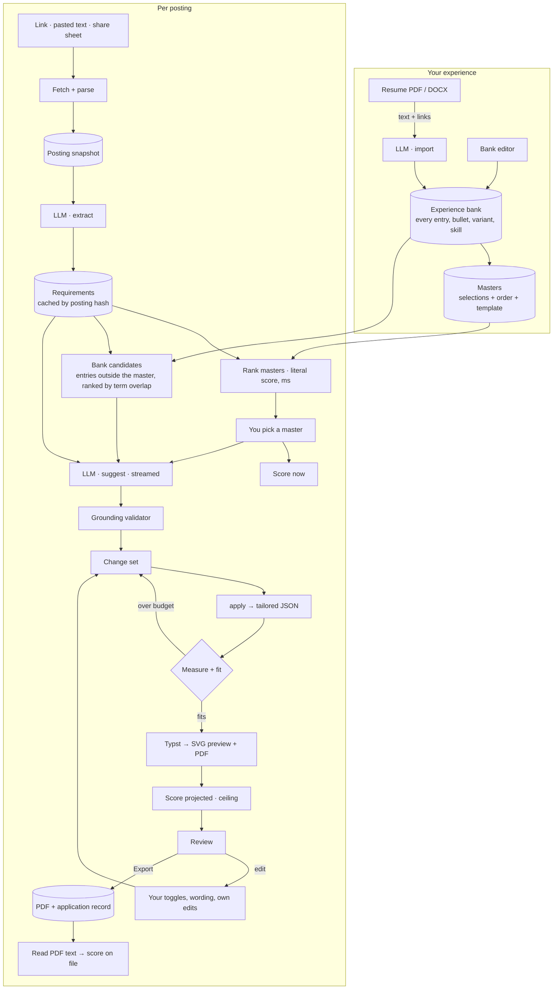
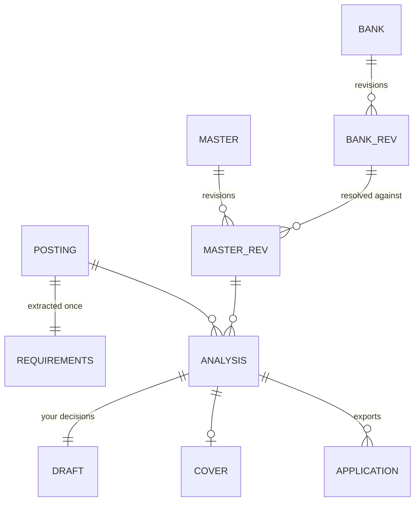
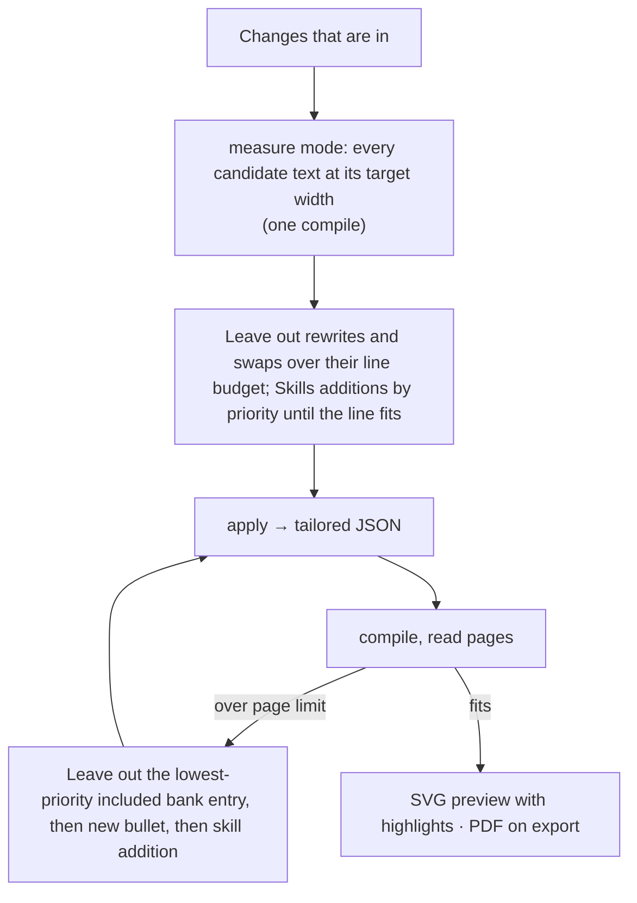

# easyshmeezy: architecture and plan

A desktop and mobile app that takes a job posting (link or text) and one of your master resumes, scores the fit,
proposes the smallest set of honest edits that raise it, lets you accept, reject or edit each one with a click, and
exports a one-page PDF in your design. macOS first; Windows and iOS from the same core.

It is the Tern plugin ATS Fit (`~/src/legacy`) rebuilt as a product: same principles, a core that
runs on every platform, an experience bank behind several masters, a composite score, faster runs, and model access
through the subscription you already pay for.

## Principles (kept from ATS Fit)

| Principle | Mechanism |
|---|---|
| The model never scores | It extracts requirements and proposes edits; code computes every percentage from rendered text |
| Nothing invented | Prompt rules, plus a grounding validator (new here) that checks each rewrite against your bank |
| The master is never touched | A tailored resume is `apply(master, changes)`; only "Save to master" writes a new revision |
| Every edit is yours to take | Each change is a toggle with its own wording field; your edits are labeled yours and never dropped by the fit check |
| One page, measured | The template reports real wrapped line counts; nothing guesses at line wrapping |
| ATS-readable | Real PDF text, read back and re-scored after export |

## What changes from ATS Fit

| ATS Fit | easyshmeezy | Why |
|---|---|---|
| One `master.json` | An experience bank (everything you've done) and masters that select from it (SWE, IT, design…) | Relevant experience outside a master isn't lost |
| `claude -p` only | `Llm` trait over your own agent CLIs: ACP agents (Codex, Gemini CLI, any registry agent) and `claude -p` | Your subscription, no API bill |
| `typst` CLI | Typst embedded as a Rust library | No install; metrics in-process |
| One evaluate call (25 s–2 min) | Two calls: **extract** (cached per posting) then **suggest** (streamed) | Score appears in seconds |
| Score = weighted skills | Composite of six components, shown as now / projected / ceiling | Requested |
| Fit loop, up to 16 compiles | One measure pass for every candidate text; compile loop only for page overflow | Speed |
| Change keys by index (`b2`, `k5`) | Keys by content hash | Your decisions survive a re-run |
| Luau re-implementation of a text field | Web text editing | Clicks place the caret; selection, IME, spellcheck for free |
| Tern kv + files | SQLite + exported files | Queries over applications; revisions |

## Stack

**Decided: Rust core + Tauri 2 shell + TypeScript UI (Svelte).**

- Typst is a Rust library; embedding it is the largest speed and portability win.
- The ACP client SDK is a Rust crate (`agent-client-protocol`, 1.0, the one Zed uses).
- Tauri 2 builds macOS, Windows and iOS from one UI codebase over that core.

| Piece | Technology | Role |
|---|---|---|
| Core | Rust crates (below) | Schemas, ingestion, scoring, change engine, rendering, model calls, storage |
| Shell | Tauri 2 | Windows, menus, commands exposed to the UI, file dialogs, clipboard, agent subprocesses |
| UI | Svelte + TypeScript on the "Paper & Ink" design system (`design/`) | Bank, masters, job, review, tracker |
| Rendering | `typst`, `typst-pdf`, `typst-svg`, `typst-render` | PDF export, SVG/PNG preview, line and page metrics |
| Fonts | Bundled OFL fonts (Liberation Serif / Tinos are metric-compatible with Times New Roman) | Same line breaks on every OS |
| Storage | SQLite (`rusqlite`) | Bank, masters and revisions, postings, analyses, drafts, applications |
| Model | Your agent CLI over ACP (`agent-client-protocol`) or `claude -p`, as a subprocess | Extract, suggest, rewrite, import, cover letter |
| Posting fetch | `reqwest` + HTML parsing (`scraper`) | Board APIs, JSON-LD `JobPosting`, `<main>` text |
| Resume import | PDF text + link annotations (pdfium, or PDFKit on Apple); DOCX via its XML | Import into the bank |

## The whole flow



## 1. Model access: your subscription, through your own agent

**Viable on desktop, with conditions.** The app never calls a model API itself and never sees a credential. It
launches an agent CLI you installed and signed in to, and talks to it over stdio: Agent Client Protocol (ACP) for
agents that speak it, `claude -p` for Claude. Usage bills to your subscription under your own agreement with the lab.

### Per lab

| Lab | Agent the app launches | Subscription sign-in | Terms (checked Oct 2026) | Verdict |
|---|---|---|---|---|
| OpenAI | `codex-acp` (ACP adapter that runs the Codex CLI) | ChatGPT login, advertised by the adapter as an ACP auth method | Codex supports "Sign in with ChatGPT for subscription access" | Use over ACP |
| Google | `gemini --acp` (native ACP mode) | Google AI Pro/Ultra; free tier moved to Antigravity CLI on 2026-06-18 | Third-party software may not "harvest or piggyback on Gemini CLI's OAuth"; launching the official binary, which signs in itself, is the registry/IDE integration path | Use over ACP; never touch its tokens |
| Anthropic | `claude -p` (the unmodified Claude Code binary) | Pro/Max via Claude Code's own `/login` | Third-party developers may not "offer Claude.ai login" or route requests through plan credentials for their users, and Agent SDK products should use API keys; the terms don't prevent "an end user signing in to the unmodified Claude Code binary with their own Claude subscription" | Use `claude -p`, **not** the ACP adapter (`claude-agent-acp` is built on the Agent SDK) |
| Others (Copilot, Cursor, Mistral, Qwen…) | Any agent in the ACP registry | Theirs | Theirs | Available through the same ACP path; not tested by default |

Sources: [Claude Code legal and compliance](https://code.claude.com/docs/en/legal-and-compliance),
[Claude plan usage of the Agent SDK](https://support.claude.com/en/articles/15036540-use-the-claude-agent-sdk-with-your-claude-plan),
[Codex authentication](https://developers.openai.com/codex/auth),
[codex-acp](https://github.com/agentclientprotocol/codex-acp), [Gemini CLI ACP mode](https://geminicli.com/docs/cli/acp-mode/),
[Gemini CLI FAQ](https://geminicli.com/docs/resources/faq), [ACP agents](https://agentclientprotocol.com/get-started/agents).

Personal use is clearly fine. Before selling the app, get written confirmation from each lab: these terms changed
twice in 2026 (Anthropic paused one change in June and added API credits to Max in October).

### What ACP doesn't give, and how the app makes up for it

ACP is built for coding agents in editors, not for one-shot structured calls.

| Gap | Handling |
|---|---|
| No JSON-schema output | Schema and rules go in the prompt; core validates against the JSON Schema; one repair turn quoting the error; then fail with the raw text shown |
| No system prompt in v1 (an unstable `systemPrompt` capability is in the spec; `claude-agent-acp` and others use `_meta`) | Use `systemPrompt` when the agent advertises it; otherwise the instructions open the first prompt block |
| Agents have tools (read files, run shells, search the web) | Client advertises no `fs` or terminal capability, passes no MCP servers, denies every permission request, and sets `cwd` to an empty temp folder per call |
| Agent process start-up and a large built-in prompt | One warm process per agent, started with the app; a new session per call (`session/new`), so calls stay independent |
| Model choice | ACP session config options (the model category is stable); the header lists what the agent offers |
| Prompt caching | Not controllable; the agent decides |
| Desktop only: stdio means a subprocess | iOS can't spawn processes; Streamable HTTP transport is a draft. See iOS below |

`claude -p` keeps ATS Fit's exact call (`--json-schema`, `--system-prompt`, `--tools ""`, no settings, no session),
so Claude gets real schema enforcement.

### The provider trait

```rust
trait Llm {
    /// One stateless call: instructions + input → JSON valid against `schema`.
    async fn structured(&self, call: Call<'_>, schema: &Schema) -> Result<Value>;
    /// Same, streaming partial JSON for the suggestion list.
    fn stream(&self, call: Call<'_>, schema: &Schema) -> BoxStream<'_, Result<Partial>>;
}
```

| Provider | Platforms |
|---|---|
| `Acp { command, args }` (codex-acp, `gemini --acp`, registry agents) | macOS, Windows |
| `ClaudeCli` | macOS, Windows |
| iOS: decided at M6 | `MacRelay` (the desktop app runs the call for the phone) or `ApiKey` (your own key) |

Settings shows each found agent, whether it's signed in (ACP auth methods; `claude` exit status), and its models.
Setup links install a missing agent; the app never bundles one.

## 2. Data model: an experience bank and masters

### The bank

Everything you've done, in one document: every job, project, school, certification and skills line, including
graphic design and other roles you don't show for SWE. Same shape as ATS Fit's master, plus:

| Field | Purpose |
|---|---|
| `kind` per section (`summary`, `experience`, `projects`, `education`, `skills`, `certifications`, `custom`) | Scoring knows where titles, degrees and skills live; standard-heading check |
| `start`, `end` (ISO month, `end` may be `"present"`) beside printed `dates` | Years of experience, computed |
| `variants[]` per bullet | Phrasings you wrote and approved; the model prefers choosing one over writing new text |
| `skills[]` per bullet | Skills you say the bullet demonstrates: evidence without the model guessing |
| `tags[]` per entry (`swe`, `design`, `it`…) | Filters in the editor; a hint for candidates |

```json
{
  "schema": 2,
  "name": "Jane (JJ) Doe",
  "contact": [{ "text": "jane.doe@example.com", "url": "mailto:jane.doe@example.com" }],
  "sections": [
    {
      "id": "work", "kind": "experience", "title": "WORK & LEADERSHIP EXPERIENCE",
      "entries": [{
        "id": "nhs", "name": "Northwind Historical Society", "url": "", "place": "Springfield, IL",
        "dates": "June 2026 – Sep 2026", "start": "2026-06", "end": "2026-09",
        "subtitle": "Software Engineer Intern", "tags": ["swe"], "notes": [],
        "bullets": [{
          "id": "nhs.2",
          "text": "Built backend REST API integrations moving business-directory and member-offer data to …",
          "variants": ["Integrated REST APIs that moved directory and member-offer data to …"],
          "skills": ["REST APIs", "Webhooks"]
        }]
      }]
    },
    {
      "id": "skills", "kind": "skills", "title": "SKILLS",
      "groups": [{ "id": "tools", "label": "Tools & Technologies", "items": ["Git", "GitHub CI/CD", "Figma"] }]
    }
  ]
}
```

### A master

A selection from the bank: which sections, entries and bullets, in what order, which variant of each bullet, which
skills, under what title and template. It holds no text of its own.

```json
{
  "id": "swe", "title": "Software Engineering", "template": "classic-serif", "pageLimit": 1,
  "sections": [
    { "id": "work", "title": "WORK & LEADERSHIP EXPERIENCE",
      "entries": [{ "id": "nhs", "bullets": [{ "id": "nhs.1" }, { "id": "nhs.2", "variant": 0 }] }] },
    { "id": "skills", "groups": [{ "id": "tools", "items": ["Git", "GitHub CI/CD"] }] }
  ]
}
```

`resolve(bank, master)` produces the same resume JSON ATS Fit's template already reads, so rendering, scoring and
the change engine never see the difference. A v1 → v2 migrator turns your `master.json` into a bank and an `swe`
master that selects all of it.

**Editing:** fix a bullet in the bank and every master that shows it gets the fix. A wording that only suits one
track is a variant, and the master picks it.

### Trying both methods

The bank model holds both methods, so the app can switch between them without a second data model:

| Mode | Suggest sees | Can propose |
|---|---|---|
| **Master only** (ATS Fit today) | The resolved master | Rewrites, skills, swaps, cuts within it |
| **Bank-aware** | The master, plus up to 5 bank entries outside it, ranked by requirement-term overlap (computed in code, before the call) | All of the above, plus: include an entry or bullet from the bank, swap one entry for another |

Bank suggestions are listed in their own group, **From your bank**, each with its points and the line cost, and are
off by default until the experiment says otherwise.

Measured on fixture postings and your real applications (logged per application):

| Metric | Question |
|---|---|
| Ceiling, bank-aware minus master-only | Does the bank find points the master can't? |
| Share of bank suggestions you accept | Are they relevant or noise? |
| Suggest latency and prompt size, each mode | What does it cost? |
| Fit-loop drops caused by bank additions | Do they crowd out better changes on one page? |

After about 25 applications, keep the mode that wins as the default and the other as a toggle.

### Everything else



| Record | Holds |
|---|---|
| Bank / master revisions | Immutable JSON keyed by content hash; an analysis records the bank and master revisions it used |
| `Posting` | URL, fetched text, text hash, title/company/location from JSON-LD, fetched at |
| `Requirements` | Extract output; keyed by posting hash, so switching masters never re-extracts |
| `Analysis` | Suggest output for one posting × master revision, mode, validator results, agent and model, time |
| `Draft` | Decisions by change key (`on`, `off`, `forced`), your wording, your own changes; append-only, so undo/redo replays it |
| `Application` | Status (saved, applied, interviewing, offer, rejected), dates, files, scores now/projected/on file, notes |
| `Cover` | Greeting, paragraphs, closing; per analysis |

## 3. Model calls

Every call goes through `Llm::structured`: no tools, no history, a pure function of instructions, schema and input.
Prompts and schemas are files in `prompts/`, built in and overridable from a dev folder.

| Call | Input | Output |
|---|---|---|
| Extract | Posting text | `Requirements` |
| Suggest (streamed) | Tagged master; bank candidates in bank-aware mode; `Requirements`; posting | `Suggestions` |
| Rewrite one | Master, posting, the line, your note ("shorter", "mention Kafka") | One line |
| Import | Resume text, links | Bank entries (merged into the bank; duplicates by name and dates are offered, not merged silently) |
| Cover letter / one paragraph | Tailored resume, posting, letter, note | Letter / paragraph |

Extract can use a faster model than suggest where the agent offers a choice.

### Extract: what the posting asks for (master-independent)

| Field | Content |
|---|---|
| `role`, `company`, `short_role`, `location`, `seniority` | As ATS Fit, plus seniority (intern, entry, mid, senior, lead) |
| `skills[]` | `term` (posting's exact words), `aliases[]`, `kind` (hard, tool, domain, soft), `priority` 1–3, `required` |
| `title_terms[]` | Words of the job title an ATS matches on |
| `years_min`, `degree` (level, fields), `certifications[]` | Hard requirements; null when absent |
| `knockouts[]` | Clearance, work authorization, on-site location |

### Suggest: what to change (master-dependent)

ATS Fit's `schema.json`, with evidence, sources and bank operations added:

| Field | Content |
|---|---|
| `verdict`, `headline` | apply / tailor / stretch / skip; one line |
| `evidence[]` | Per requirement skill: `have` (yes / add / no) and `ids[]`, the lines that back it |
| `keywords[]` | As ATS Fit: add / edit / drop a term on a Skills line, note line or bullet |
| `bullets[]` | rewrite / add / cut, `id`, `before`, `after`, `hits[]`, `sources[]` (ids it draws facts from), `variant` (when it picked one of yours) |
| `skills_ops[]` | Add, remove, rename or reorder Skills items |
| `bank[]` | Bank-aware only: include an entry or bullet, or swap entries, with `why` and the skills it adds |
| `order[]` | Optional reorder of entries within a section |
| `summary` | Optional summary line, only from facts in the bank |
| `gaps[]` | Unsupported requirements, with one honest fix each |

Rules kept word for word from `prompt.md`: never invent; the posting's exact words; line budget; in-place swaps keep
the part of speech; tags are never text.

### Grounding validator (new)

Runs on every model-written line before it becomes a change; closes ATS Fit's stated limit "nothing checks the
model's wording against the resume".

- Numbers, percentages, money and dates in `after` must appear in its `sources` lines.
- Proper nouns and tool names (alias dictionary + capitalized tokens) must appear in the bank, or be a requirement
  skill whose evidence is `yes` or `add`.
- `before` must equal the line it names; every `id` must exist.
- A line that fails starts **left out**, with the reason (`"40%" is not in your resume`); you can force it in.

## 4. The composite score

The model gives no number. Code computes every component from text, so the same page always gets the same score.

| Component | Default weight | Measured from | Edits can move it |
|---|---|---|---|
| Hard skills and tools | 45 | Requirement skills of kind hard/tool found on the page, weighted 3/2/1 by priority, `required` ×1.5 | Yes |
| Domain and soft keywords | 10 | Same, kinds domain/soft | Yes |
| Job title | 10 | `title_terms` in a subtitle or summary: 1 exact, 0.5 partial | Yes, only when backed |
| Experience | 15 | Years from `start`/`end` of entries the evidence marks relevant, vs `years_min`: `min(1, have/need)` | Only by including a bank entry |
| Education and certifications | 10 | Degree level and field vs requirement; certifications matched literally | Only by including a bank entry |
| Format | 10 | Template is ATS-safe (single column, real text), standard headings, email and phone present, within `pageLimit`, PDF read-back matches | Page limit only |

Components the posting doesn't specify drop out, and the rest are renormalized:

$$S = \frac{\sum_c w_c\, s_c}{\sum_{c \in \text{present}} w_c}, \qquad s_c \in [0, 1]$$

**Matching is literal, like ATS Fit's `literal_fit`:** whole-term matches ("Java" is not in "JavaScript"), with an
alias dictionary (`JS` ↔ `JavaScript`, `k8s` ↔ `Kubernetes`) and near forms (plural, hyphenated, "&"/"and") reported
separately as "with near forms".

**Three numbers, all measured, none predicted:**

| Number | Text it's computed from |
|---|---|
| **Now** | The master, rendered |
| **Projected** | The draft as you have it (live, every rebuild) |
| **Ceiling** | Every suggestion and every backed skill addition applied, after the fit check, so it is reachable on one page (bank suggestions included only in bank-aware mode) |

Gaps you mark "I meet this off the resume" show as a separate `+n`, so the page score stays honest.

**Best master:** every master's literal score against the requirements is computed in milliseconds and the best is
preselected.

This models a literal-matching ATS. Real systems differ (some only parse and filter; some rank on keywords); the
number is a guide to coverage, not a prediction of any vendor's ranking.

## 5. Changes

`changes_of(suggestions, master)` turns suggestions into `Change`s; `draft` layers your decisions on top; `apply`
produces the tailored JSON. All three are pure functions in `resume-core`.

| Op | Target | Effect |
|---|---|---|
| `rewrite` | bullet | Text becomes `after` (old text kept as `orig` for the line budget) |
| `use_variant` | bullet | Text becomes one of your variants |
| `cut` / `add` | bullet / entry | Remove a bullet / insert one under an entry |
| `skill_add` / `skill_remove` / `skill_rename` / `skill_move` | Skills line | Edit one item |
| `note_add` | note line | Append a term |
| `swap` | bullet or note line | Replace or cut words in place |
| `set` | any line | Your own text (an edited swap or rewrite becomes `set`) |
| `include` / `exclude` | bank entry or bullet | Show or drop it for this posting |
| `swap_entry` | two entries | Replace one entry with a bank entry in the same place |
| `reorder` | entries | Order for this posting |
| `summary` | summary | Set the summary line |

**Keys** are `hash(op, target, before)`, so a re-run that proposes the same change keeps your decision and wording.

**Whether a change is in** (ATS Fit's state machine, unchanged):

```mermaid
stateDiagram-v2
  [*] --> In
  [*] --> LeftOut: validator or word swap flags it
  [*] --> Off: bank suggestion (while the experiment runs)
  In --> LeftOut: fit check (over its lines, Skills line wraps, over page limit)
  In --> Off: you turn it off
  Off --> In: you turn it on
  LeftOut --> Forced: you turn it on
  Forced --> Off: you turn it off
  note right of Forced: never removed again; warns if it runs long
```



Your own skills, wording and edits are never left out by the fit check; they only warn.

**Save to master** writes chosen changes back: a rewrite becomes a new variant of its bullet in the bank (or replaces
its text, if you choose), and the master selects it; an `include` adds the entry to the master.

## 6. Rendering

`resume-render` implements Typst's `World` over in-memory sources: the template, the tailored JSON, bundled fonts.
One long-lived world per open review means Typst's memoization makes rebuilds incremental.

### Template contract

A template is a `.typ` file plus a manifest (`name`, `atsSafe`, `columns`, preview image). It must:

1. Read the resume from `sys.inputs.data` (JSON string, not a path: no file system on iOS).
2. Record `<bullet>` and `<group>` metadata (`id`, `lines`, `orig`) and `<pages>`, as `resume.typ` does.
3. Highlight `changed` lines and `added` skills when `sys.inputs.highlight == "1"`.
4. In `sys.inputs.mode == "measure"`, lay out a list of candidate texts at the width of the line each targets and
   record their line counts.

`classic-serif` is a port of ATS Fit's `resume.typ` (11pt, 0.5in margins, ruled headings, 12.62pt pitch). A test
compiles every template against fixture resumes and checks the metadata.

### Fit, in one pass instead of a loop



A bullet's line count depends only on its own text and column width, so per-line decisions need one measure compile;
only the page count needs the loop.

### Outputs

| Output | Use |
|---|---|
| SVG per page (`typst-svg`) | Live preview: crisp at any zoom, text selectable |
| PNG (`typst-render`) | Thumbnails, sharing |
| PDF (`typst-pdf`) | Export, compiled without highlights; then its text is extracted and re-scored ("score on file") |

## 7. Postings in

| Source | How |
|---|---|
| Pasted link | Board APIs where public (Greenhouse, Lever, Ashby job JSON), else schema.org `JobPosting` JSON-LD, else `<main>` text; LinkedIn search links rewritten to the job page, as in ATS Fit |
| Pasted text | Used as is |
| macOS | Global hotkey "evaluate clipboard"; share extension from Safari |
| iOS | Share extension from Safari and the LinkedIn app (a native Swift target beside the Tauri app) |
| Blocked sites (Indeed: HTTP 401) | The app says to paste the text |

## 8. Storage

| Where | What |
|---|---|
| App data `easyshmeezy.sqlite` | `bank_revs`, `masters`, `master_revs`, `postings`, `requirements`, `analyses`, `drafts`, `applications`, `covers`, `settings` |
| User-chosen folder (default `~/Documents/Resumes`) | Exported PDFs `<company>_<short_role>_<surname>_resume.pdf` (`-2`… when taken), `applications.csv` |
| The agents' own config | Their sign-ins; the app stores none |

Rows use UUIDs and `updated_at` so sync can be added later without a migration. No sync until decided.

## 9. UI

Visual language, tokens, components, motion and screen recipes: [`design/DESIGN.md`](design/DESIGN.md), binding for
every screen. `design/specimen.html` shows every component state and the composed Review screen.

| Screen | Content |
|---|---|
| Bank | Every entry, filterable by tag and section; which masters show each; editor with variants and skills per bullet |
| Masters | Cards (track, template thumbnail, last edited); a master's editor is checkboxes and drag-to-order over the bank, with live preview |
| Job | Posting input; requirements as chips; master picker with each master's score; score header |
| Review | Score header; changes grouped by section, then **From your bank**; live preview beside them |
| Applications | Table with status, scores, files, posting link; CSV export |
| Settings | Agents found, signed in or not, model per call; mode (master only / bank-aware); export folder; default template |

**Score header:** `Now 53%` → `Projected 78%` (large, live) with `Ceiling 85%` beside it; a bar showing now, the gain
from your selections, and the headroom left; components on hover.

**Every change is one row:** checkbox (in/out), the line as it will read with inserted terms highlighted, the text it
replaces, `+n pts`, and actions: Edit (inline field), Rewrite with a note (one model call for that line), Save to
master. Skill chips toggle with a click: gray → yours (adds it to its line), green → not yours (removes it).

**Keyboard first** (carried from ATS Fit): `↑` `↓` select, Space toggle, `⏎` edit, `a` add your own, `e` export,
`r` re-run, `⌘Z` / `⇧⌘Z` undo/redo over the draft log.

Compact layout (iOS, narrow windows): the preview becomes a tab.

## 10. Repository layout

```
easyshmeezy/
  Cargo.toml                 workspace
  crates/
    resume-core/             bank/master types (serde + JSON Schema), resolve, ids, change engine, apply, matcher, score, validator
    resume-render/           Typst World, fonts, templates, measure, PDF/SVG/PNG, PDF text read-back
    resume-llm/              Llm trait, ACP client provider, claude CLI provider, agent discovery, JSON repair, prompts
    resume-ingest/           posting fetch/parse, PDF/DOCX import
    resume-store/            SQLite schema, migrations, queries
    ez-cli/                  `ez render | score | tailor | import | eval` for development and evals
  app/
    src-tauri/               Tauri commands over the crates
    src/                     Svelte UI
  templates/                 *.typ + manifests; fonts/
  design/                    DESIGN.md, tokens.css, components.css, specimen.html, lint.mjs, UI fonts
  prompts/                   extract, suggest, rewrite, import, cover (.md + .schema.json)
  data/aliases.json          skill alias dictionary
  fixtures/                  banks, masters, postings, recorded model outputs
```

## 11. Testing

| Layer | What |
|---|---|
| Unit (`resume-core`) | Resolve, matcher (whole terms, aliases, near forms), dates and years, `apply` per op, key stability across re-runs, validator cases, bank candidate ranking |
| Golden | `fixtures/postings × fixtures/masters` with recorded model outputs → score components, tailored JSON, page count; deterministic, in CI |
| Templates | Every template × every fixture resume compiles, emits the contract's metadata, and round-trips its PDF text |
| Providers | A fake ACP agent (the SDK's `Agent` trait) in tests: permission requests denied, malformed JSON repaired once, timeouts |
| Prompt evals (`ez eval`, not CI) | Live runs per agent over fixtures: schema failures, repairs, validator and line-budget violations, latency; both modes |

## 12. Speed targets

| Step | Target |
|---|---|
| Link → requirements and every master's score | ≤ 8 s (agent turn overhead included) |
| First suggestion on screen | ≤ 8 s after the master is picked |
| All suggestions | ≤ 30 s |
| Toggle or edit → new preview and score | ≤ 150 ms |
| Export | ≤ 300 ms |

The model-call targets are set by the provider spike (M0), not assumed.

## 13. Roadmap

| Milestone | Delivers | Done when |
|---|---|---|
| M0 Spike: providers | `ez llm` running the extract prompt through `claude -p` on the 11 postings in `fixtures/postings/`; `codex-acp` and `gemini --acp` join once core features work | JSON valid without repair, with one repair, latency p50/p90; go/no-go per agent |
| M1 Core + render | Bank and master types, resolve, v1 migrator, Typst world, `classic-serif`, metrics, `ez render` | Your current `master.json` renders identically to ATS Fit's PDF |
| M2 Requirements + score | Ingest, extract, matcher, composite score, master ranking, `ez score <url> --master swe` | Score components for the 11 fixture postings |
| M3 Tailor | Suggest, validator, change engine, measure + fit, both modes, `ez tailor` | One-page tailored PDFs for the fixtures; the bank-aware ceiling measured beside master-only |
| M4 macOS app | Bank, masters, job, review with live preview, export, applications log, agent settings | You use it instead of ATS Fit |
| M5 Experience | PDF/DOCX import into the bank, variants, second template (design track), the mode experiment's report | Decision on the default mode |
| M6 Around the application | Cover letters, application statuses, CSV, rewrite-with-note | Parity with ATS Fit, plus tracking |
| M7 Windows + iOS | Windows build and installer (agents run there too); iOS share extension, compact layout, iOS model access decided | Same fixture outputs on all three |
| M8 Distribution | Signing, notarization, auto-update; labs' written OK for subscription use | Installable by someone else |

## 14. Open decisions

| Decision | Status |
|---|---|
| UI stack | **Decided:** Tauri 2 + Svelte over a Rust core |
| Model access on desktop | **Decided:** your own agents: `claude -p` first; ACP (Codex, Gemini CLI, registry) added after core features work; no API keys |
| Bank-aware vs master-only suggestions | **Experiment** in M3–M5 on one data model; default chosen from the metrics |
| Sync | **Not yet** |
| Model access on iOS | Open until M7: Mac relay (needs pairing, close to sync) or your own API key |

## 15. Risks

| Risk | Mitigation |
|---|---|
| A lab changes its terms or blocks subscription use from other apps | Several labs behind one trait; the app never handles credentials; re-check terms each release |
| Agent CLIs change flags, auth or ACP versions | Pin tested versions in settings; the M0 spike becomes `ez eval` run before each release |
| Agents return prose or broken JSON without schema enforcement | Validation + one repair turn; `claude -p` keeps real schema enforcement; per-agent failure rates tracked |
| An agent tries to use tools | No fs/terminal capability, no MCP servers, every permission denied, empty temp `cwd` |
| Users must install and sign in to a CLI (and Node for adapters) | Settings detects agents and links the install and sign-in steps |
| The score is mistaken for a real ATS's | Label it as literal-match coverage; show components; read back from the PDF |
| Model wording claims more than the bank | Validator, sources per rewrite, your variants preferred, everything reviewable before export |
| Bank suggestions add noise or crowd the page | Off by default, own group, measured in the experiment |
| Job boards block fetching or change markup | Board APIs and JSON-LD first; paste always works; parser fixtures per board |
| Font metrics differ across platforms | Bundled fonts only; no system font fallback in templates |
| Design-track resumes want multi-column layouts that ATS parsers mangle | Template manifest `atsSafe`; Format component and a warning when it isn't |
