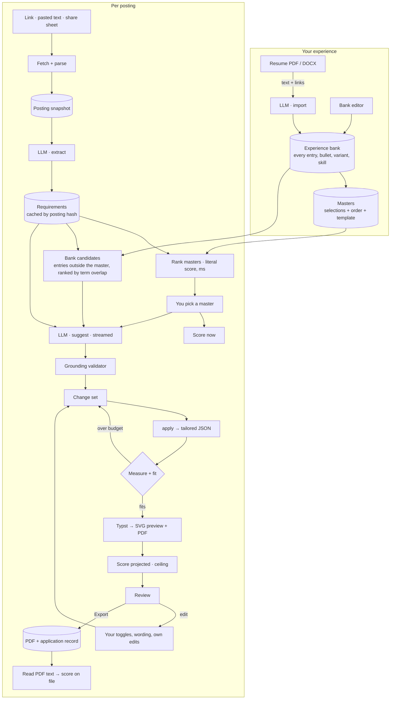
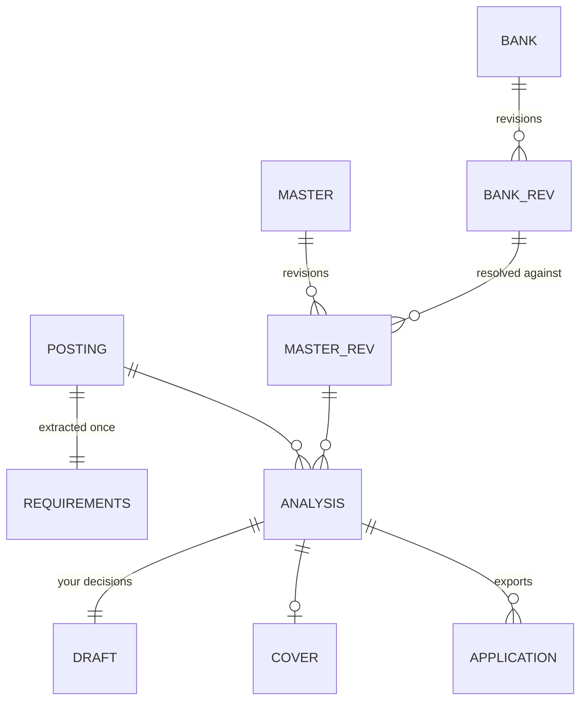
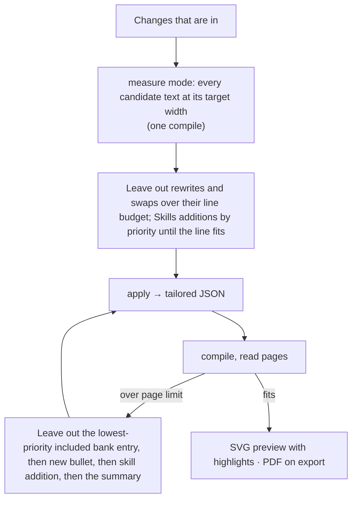

# gliide: architecture and plan

A desktop and mobile app that takes a job posting (link or text) and one of your master resumes, scores the fit,
proposes the smallest set of honest edits that raise it, lets you accept, reject or edit each one with a click, and
exports a one-page PDF in your design. macOS first; Windows and iOS from the same core.

Its goals: a core that runs on every platform, an experience bank behind several masters, a composite score, fast
runs, and model access through the agent subscription you already pay for.

## Principles

| Principle | Mechanism |
|---|---|
| The model never scores | It extracts requirements and proposes edits; code computes every percentage from rendered text |
| Nothing invented | Prompt rules, plus a grounding validator that checks each rewrite against your bank |
| The master is never touched | A tailored resume is `apply(master, changes)`; only "Save to master" writes a new revision |
| Every edit is yours to take | Each change is a toggle with its own wording field; your edits are labeled yours and never dropped by the fit check |
| One page, measured | The template reports real wrapped line counts; nothing guesses at line wrapping |
| ATS-readable | Real PDF text, read back and re-scored after export |

## Design choices

| Choice | Why |
|---|---|
| An experience bank (everything you've done) and masters that select from it (SWE, IT, design…), rather than one resume file | Relevant experience outside a master isn't lost |
| `Llm` trait over your own agent CLIs: ACP agents (Codex, Gemini CLI, any registry agent) and `claude -p` | Your subscription, no API bill |
| Typst embedded as a Rust library, not the `typst` CLI | No install; metrics in-process |
| Two calls, **extract** (cached per posting) then **suggest** (streamed), rather than one evaluate call (25 s–2 min) | Score appears in seconds |
| A composite of six components, shown as now / projected / ceiling | Shows which part of the fit is missing and what edits can still move |
| One measure pass for every candidate text; a compile loop only for page overflow | Speed: no compile per attempt |
| Change keys by content hash, not by index (`b2`, `k5`) | Your decisions survive a re-run |
| Web text editing | Clicks place the caret; selection, IME, spellcheck for free |
| SQLite + exported files | Queries over applications; revisions |

## Stack

**Decided: Rust core + Tauri 2 shell + TypeScript UI (Svelte).**

- Typst is a Rust library; embedding it is the largest speed and portability win.
- The ACP client SDK is a Rust crate (`agent-client-protocol`, 1.0, the one Zed uses).
- Tauri 2 builds macOS, Windows and iOS from one UI codebase over that core.

| Piece | Technology | Role |
|---|---|---|
| Core | Rust crates (below) | Schemas, ingestion, scoring, change engine, rendering, model calls, storage |
| Shell | Tauri 2 | Windows, menus, commands exposed to the UI, file dialogs, clipboard, agent subprocesses |
| UI | Svelte + TypeScript on the "Paper & Ink" design system (`design/`) | Bank, masters, job, review, tracker |
| Rendering | `typst`, `typst-pdf`, `typst-svg`, `typst-render` | PDF export, SVG/PNG preview, line and page metrics |
| Fonts | Bundled OFL fonts (Liberation Serif / Tinos are metric-compatible with Times New Roman) | Same line breaks on every OS |
| Storage | SQLite (`rusqlite`) | Bank, masters and revisions, postings, analyses, drafts, applications, interview rounds, preps, practice and debriefs, stories |
| Model | Your agent CLI over ACP (`agent-client-protocol`) or `claude -p`, as a subprocess | Extract, suggest, rewrite, import, cover letter, invite, prep, practice, Dig, debrief |
| Posting fetch | `reqwest` + HTML parsing (`scraper`) | Board APIs, JSON-LD `JobPosting`, `<main>` text |
| Resume import | PDF text and link annotations in pure Rust (`resume_render::pdf_read`, the read-back's glyph layout over `hayro`); DOCX via its XML (`zip` + `roxmltree`); Markdown and text as written | Import into the bank |

## The whole flow



## 1. Model access: your subscription, through your own agent

The app never calls a model API itself, and never ships, reads or stores a credential. It launches an agent CLI you
installed and signed in to yourself, and talks to it over stdio: Agent Client Protocol (ACP) for agents that speak it,
`claude -p` for Claude. Usage bills to your own subscription, and your own agreement with each lab applies to it.

### Per lab

| Lab | Agent the app launches | Subscription sign-in |
|---|---|---|
| OpenAI | `codex-acp` (ACP adapter that runs the Codex CLI) | ChatGPT login, advertised by the adapter as an ACP auth method |
| Google | `gemini --acp` (native ACP mode) | Google AI Pro/Ultra, done by the official Gemini CLI itself; the app never touches its tokens |
| Anthropic | `claude -p` (the unmodified Claude Code binary), not the ACP adapter (`claude-agent-acp` is built on the Agent SDK) | Pro/Max via Claude Code's own `/login` |
| Others (Copilot, Cursor, Mistral, Qwen…) | Any agent in the ACP registry, through the same ACP path; not tested by default | Theirs |

Each lab's own documentation: [Claude Code legal and compliance](https://code.claude.com/docs/en/legal-and-compliance),
[Claude plan usage of the Agent SDK](https://support.claude.com/en/articles/15036540-use-the-claude-agent-sdk-with-your-claude-plan),
[Codex authentication](https://developers.openai.com/codex/auth),
[codex-acp](https://github.com/agentclientprotocol/codex-acp), [Gemini CLI ACP mode](https://geminicli.com/docs/cli/acp-mode/),
[Gemini CLI FAQ](https://geminicli.com/docs/resources/faq), [ACP agents](https://agentclientprotocol.com/get-started/agents).
These terms change; whether your use fits them is between you and the lab.

### What ACP doesn't give, and how the app makes up for it

ACP is built for coding agents in editors, not for one-shot structured calls.

| Gap | Handling |
|---|---|
| No JSON-schema output | Schema and rules go in the prompt; core validates against the JSON Schema; one repair turn quoting the error; then fail with the raw text shown |
| No system prompt in v1 (an unstable `systemPrompt` capability is in the spec; `claude-agent-acp` and others use `_meta`) | Use `systemPrompt` when the agent advertises it; otherwise the instructions open the first prompt block |
| Agents have tools (read files, run shells, search the web) | Client advertises no `fs` or terminal capability, passes no MCP servers, denies every permission request, and sets `cwd` to an empty temp folder per call |
| Agent process start-up and a large built-in prompt | One warm process per agent, started with the app; a new session per call (`session/new`), so calls stay independent |
| Model choice | ACP session config options (the model category is stable); the header lists what the agent offers |
| Prompt caching | Not controllable; the agent decides |
| Desktop only: stdio means a subprocess | iOS can't spawn processes; Streamable HTTP transport is a draft. See iOS below |

`claude -p` is called with `--json-schema`, `--system-prompt`, `--tools ""`, no settings and no session, so Claude
gets real schema enforcement.

### The provider trait

```rust
trait Llm {
    /// One stateless call: instructions + input → JSON valid against `schema`.
    async fn structured(&self, call: Call<'_>, schema: &Schema) -> Result<Value>;
    /// Same, streaming partial JSON for the suggestion list.
    fn stream(&self, call: Call<'_>, schema: &Schema) -> BoxStream<'_, Result<Partial>>;
}
```

| Provider | Platforms |
|---|---|
| `Acp { command, args }` (codex-acp, `gemini --acp`, registry agents) | macOS, Windows |
| `ClaudeCli` | macOS, Windows |
| iOS: decided at M6 | `MacRelay` (the desktop app runs the call for the phone) or `ApiKey` (your own key) |

Settings shows each found agent, whether it's signed in (ACP auth methods; `claude` exit status), and its models.
Setup links install a missing agent; the app never bundles one. A new install's first-run setup (`/welcome`) checks
the agent too and links to its install guide; whether that setup is done is the `onboarded` setting. The setup puts
you before your tools: the resume is imported before the Agents step, so when the agent is known not to be ready the
Experience step says so and links ahead to it (import runs the model). Its What it says step writes the feed's
settings as Settings → Feed does: a filter you never touch stays Auto (`None`, following the bank); the first change
makes it yours, starting from what Auto had.

### Updates

The Rust side runs Tauri's updater plugin (`app/src-tauri/src/update.rs`); the webview never calls it and has no
updater permission. Its one endpoint is the newest GitHub release's `latest.json` (`plugins.updater.endpoints`),
which names the version, its notes, and per platform the `gliide.app.tar.gz` bundle and its signature; a bundle
installs only when that signature checks against `plugins.updater.pubkey` (minisign; the private key is the
maintainer's, `~/.tauri/gliide-updater.key`, used by `app/scripts/release-macos.sh`, which also writes
`latest.json`). Release builds check about a minute after launch and then whenever 24 hours have passed (looked at
hourly, so sleep doesn't skip a day) while the `check_updates` setting is on (default on); dev builds never check on
their own. Check now (Settings → About) checks at once. A newer version shows in the sidebar's foot and in About;
Restart to update downloads the bundle (progress at each whole percent in the `update` event), checks it, swaps the
app in place and relaunches. `UpdateStatus` is the state: `current`, `available`, `notes`, `state` (idle, checking,
installing), `progress`, `checkedAt`, `error`.

## 2. Data model: an experience bank and masters

### The bank

Everything you've done, in one document: every job, project, school, certification and skills line, including
graphic design and other roles you don't show for SWE. Same shape as a v1 resume (`master.json`: one resume's
sections, entries, bullets and skills lines), plus:

| Field | Purpose |
|---|---|
| `kind` per section (`summary`, `experience`, `projects`, `education`, `skills`, `certifications`, `custom`) | Scoring knows where titles, degrees and skills live; standard-heading check |
| `start`, `end` (ISO month, `end` may be `"present"`) beside printed `dates` | Years of experience, computed |
| `variants[]` per bullet | Phrasings you wrote and approved; the model prefers choosing one over writing new text |
| `skills[]` per bullet | Skills you say the bullet demonstrates: evidence without the model guessing |
| `tags[]` per entry (`swe`, `design`, `it`…) | Filters in the editor; a hint for candidates |
| `facts[]` per entry | What you've said about the entry that its lines don't print, each `{ id: "acme~1", text, skills[], source: { kind: review \| edit \| practice \| dig, at, posting?, company? } }` (`resume_core::facts`: an id is never renumbered; a new fact takes the number after the highest held). Never on a page; in the model's input as `[acme~1] (fact) …` after the entry's bullets, and a source for that entry's lines as its bullets are. Edited in the entry's editor (Facts), kept from the review's **Yes, at…**, from a practiced answer's **Keep as fact** (`keep_claim`: the claim in your words, said for the round's posting and company, or for none when the answer told a story alone), and at once from your Dig answers (`dig_capture`, one bank revision). Left out of the JSON while empty, so banks without facts keep their revision hash |

```json
{
  "schema": 2,
  "name": "Jane Q. Doe",
  "contact": [{ "text": "jane.doe@example.com", "url": "mailto:jane.doe@example.com" }],
  "sections": [
    {
      "id": "work", "kind": "experience", "title": "WORK EXPERIENCE",
      "entries": [{
        "id": "acme", "name": "Acme Widgets Co.", "url": "https://example.com/acme", "place": "Springfield, IL",
        "dates": "June 2025 – Sep 2025", "start": "2025-06", "end": "2025-09",
        "subtitle": "Software Engineering Intern", "tags": ["swe"], "notes": [],
        "bullets": [{
          "id": "acme.2",
          "text": "Wrote integration tests in GitHub Actions for the order API, catching 14 regressions before release",
          "variants": ["Added GitHub Actions integration tests to the order API that caught 14 regressions before release"],
          "skills": ["GitHub Actions", "Integration testing"]
        }]
      }]
    },
    {
      "id": "skills", "kind": "skills", "title": "SKILLS",
      "groups": [{ "id": "tools", "label": "Tools & Technologies", "items": ["Git", "GitHub Actions", "Docker"] }]
    }
  ]
}
```

### A master

A selection from the bank: which sections, entries and bullets, in what order, which variant of each bullet, which
skills, under what title and template. It holds no text of its own.

```json
{
  "id": "swe", "title": "Software Engineering", "template": "classic-serif", "pageLimit": 1,
  "sections": [
    { "id": "work", "title": "WORK EXPERIENCE",
      "entries": [{ "id": "acme", "bullets": [{ "id": "acme.1" }, { "id": "acme.2", "variant": 0 }] }] },
    { "id": "skills", "groups": [{ "id": "tools", "items": ["Git", "GitHub Actions"] }] }
  ]
}
```

`resolve(bank, master)` produces a plain v1 resume JSON, the shape the template reads, so rendering, scoring and the
change engine never see the difference. A v1 → v2 migrator turns a v1 `master.json` into a bank and an `swe` master
that selects all of it.

**Editing:** fix a bullet in the bank and every master that shows it gets the fix. A wording that only suits one
track is a variant, and the master picks it. An entry's details (`resume_core::details`: name, subtitle, place, dates
and the labeled lines under it) are edited the same way, in the entry editor: masters hold none of them, so every
master that shows the entry prints the new ones. New dates are read again into `start` and `end`.

**Variants** (`resume_core::variants`) come from two places: the entry editor (Experience bank → an entry: add,
edit, remove a variant, make one the bullet's text, fold a reworded duplicate bullet into another of its entry, choose
which wording each master shows) and the review (**Save as variant** keeps a rewrite or your wording of a bullet; not
offered for a line left out, since later rewrites may draw on a variant's facts). Every edit keeps each master showing
the words it showed unless the edit is about what it shows: removing a variant renumbers the others and falls back to
the text where it was shown; making a variant the text swaps the indexes; folding moves masters onto the same words,
and is refused when a master shows both bullets. Suggest already sees variants as `(variant N)` lines and prefers them
over new words; the grounding validator counts them as the bullet's own facts.

### Trying both methods

The bank model holds both methods, so the app can switch between them without a second data model:

| Mode | Suggest sees | Can propose |
|---|---|---|
| **Master only** | The resolved master | Rewrites, skills, swaps, cuts within it |
| **Bank-aware** | The master, plus up to 5 bank entries outside it, ranked by requirement-term overlap (computed in code, before the call) | All of the above, plus: include an entry or bullet from the bank, swap one entry for another |

Bank suggestions are listed in their own group, **From your bank**, each with its points and the line cost, and are
off by default until the experiment says otherwise.

Measured on fixture postings and your real applications (logged per application):

| Metric | Question |
|---|---|
| Ceiling, bank-aware minus master-only | Does the bank find points the master can't? |
| Share of bank suggestions you accept | Are they relevant or noise? |
| Suggest latency and prompt size, each mode | What does it cost? |
| Fit-loop drops caused by bank additions | Do they crowd out better changes on one page? |

After about 25 applications, keep the mode that wins as the default and the other as a toggle.

### Everything else



| Record | Holds |
|---|---|
| Bank / master revisions | Immutable JSON keyed by content hash; an analysis records the bank and master revisions it used |
| `Posting` | URL, fetched text, text hash, title/company/location from JSON-LD, fetched at |
| `Requirements` | Extract output; keyed by posting hash, so switching masters never re-extracts |
| `Analysis` | Suggest output for one posting × master revision, mode, validator results, agent and model, time |
| `Draft` | Decisions by change key (`on`, `off`, `forced`), your wording, your own changes; append-only, so undo/redo replays it |
| `Application` | Status (saved, applied, interviewing, offer, rejected), dates, files, scores now/projected/on file, notes |
| `Cover` | Greeting, paragraphs, closing; per analysis |
| `Story` | A story you tell in interviews (`resume_core::story`, `schemas/story.schema.json`): title, the entry it happened in (or none), the bullets and facts it draws on by id, situation, task, action, result, skills, themes (conflict, failure, leadership, ambiguity, deadline, impact, learning, teamwork, initiative), where it came from (`dig`, `practice` or `edit`, when, and `from`: the practice turn or Dig capture it was drawn from) and when it last changed |
| `Debrief` | What you wrote down after a round, one per round: the questions they asked (a prep question by its id, or typed by you), what you got stuck on, notes; when it was saved (`Round.debriefed_at`); what reading it found (Dig questions per entry, notes for the next prep, the model), cleared when the debrief changes. A round awaits its debrief once it's upcoming, scheduled and over (start plus length, an hour when unknown) with none saved; an application's `debrief_due` is its latest such round that ended within the last 14 days, and its `last_activity` the latest of its status changes, its rounds' ends that have passed (not cancelled ones) and its debriefs |

**Stories are their own record, not part of the bank.** A story is interview material: it never prints, and it
changes as you practice (a tighter telling, a new result). A bank revision is immutable and recorded by every
analysis, so keeping stories in the bank would churn revisions (and rehash what analyses point at) for edits no page
ever shows. They live in the store's `stories` table and refer to the bank by id. A link the bank no longer holds
reads "gone" and the story stays usable; folding a bullet into another (`edit_entry` `fold`) moves every story's link
onto the bullet it folded into in the same write. A story drawn from an answer (`source.from` set) may state only the
numbers its bullets (text and variants), its facts or that answer state (`resume_core::story::unsourced`; `save_story`
refuses it otherwise); words you type are your word, as a fact is, and an existing story saved without `from` keeps
where it came from. How long it takes to tell (its words at 150 a minute) and the themes no story covers are computed,
not stored. Removing one deletes the row and hands it back to the UI; Undo saves it again by its id, and its
tellings, which keep the story's id, find it again.

## 3. Model calls

Every call goes through `Llm::structured`: no tools, no history, a pure function of instructions, schema and input.
Prompts and schemas are files in `prompts/`, built in and overridable from a dev folder.

| Call | Input | Output |
|---|---|---|
| Extract | Posting text | `Requirements` |
| Suggest (streamed) | Tagged master; bank candidates in bank-aware mode; `Requirements`; posting | `Suggestions` |
| Rewrite one | Master, posting, the line, your note ("shorter", "mention Kafka") | One line |
| Instruct | Tailored resume as it reads now (tagged, with budgets, variants and skills), requirement terms marked on or off the page, scope, your instruction | A reply, up to 6 edits, what it skipped |
| Import | Resume text, links (`anchor text -> URL`) | The resume word for word, in the v1 resume shape (`prompts/import.md`); merged into the bank by code (below) |
| Cover letter / one paragraph | Tailored resume, posting, letter, note | Letter / paragraph |
| Invite | A pasted interview invite, today's date, the Mac's UTC offset and time zone, the application's company and role | One round's kind, start (RFC 3339 with the invite's offset), length, who, where, notes; each null or empty when the invite doesn't state it (`prompts/invite.md`); a start that doesn't parse is dropped. An `.ics` file is read in Rust instead, no call |
| Prep | A round's kind, who, notes; the application's role and company; the posting's requirement skills (one a line, required, preferred or nice to have); the resume as sent, tagged (`[summary]`, `[acme#1]`, `- [acme.2]`) with each entry's facts under it, or the exported PDF's text without ids; your stories, one a line by place (`[s1] Title (themes…; entry…; bullets…)`); the application's earlier rounds' debriefs, when there are some (each round's kind and date, what they asked, what you got stuck on, your notes, the notes its read left for the next prep; `prompts/prep-debriefs.md` joins the instructions then); today's date | Focus (a sentence), 6–10 likely questions (resume, skills, behavioral, logistics; each with why, the lines it's about and the story that answers it, by place, turned into its id by code: an unknown one is dropped, one you've removed since reads as none), gaps (each required term the page doesn't show, with an honest answer and its lines), 3–5 questions to ask them (`prompts/prep.md`). Kept in `preps` by prompt, posting, resume as sent and round, and the earlier debriefs when there are some (a debrief saved or read means a fresh prep for the rounds after it), not the bank's revision nor your stories (a fact kept or a story saved from practice would otherwise rewrite it and renumber its questions); **Write again** writes it anew from the bank and stories as they are |
| Practice | One prep question (text, why, its lines with their text, and the story it links, its parts as saved), your typed answer, the posting's requirement terms, the resume as sent with facts, as Prep reads it | Feedback, never a grade: lines it drew on; situation, task, action, result each yes, thin or no, with a note on the weakest; mismatches with the resume; new claims per entry; a tighter telling; the likely follow-up; the answer as a story to keep (title, entry, the bullets and facts it cites, situation, task, action, result in first person, skills, themes; null when it tells none) (`prompts/practice.md`). Kept in `practice` with the question's story |
| Tell it | Practice's call and prompt for one story told alone: the question it answers (from its themes), the story as saved, its bullets as the lines, your telling, its skills as the terms, and its entry as the bank holds it (`SentResume::entry`: bullets with variants and skills, facts) instead of a resume sent | Practice's feedback; kept in `practice` with no round and the story's id, job `story:<id>` |
| Dig questions | One bank entry tagged (header, note lines, bullets with variants and skills, facts), the titles of the masters that show it, the requirement terms your stored postings ask for that the entry doesn't state (code: each posting's latest requirements, counted by postings asking then weight, literal and alias matches against the entry's every line, top 8), today's date | A read of the entry (1–2 sentences) and 4–6 questions, each about a bullet or the entry (`prompts/dig-questions.md`); code numbers them `d1`…, labels each by its bullet's place ("Bullet 2", "The entry"; an id that isn't the entry's reads as the entry). Kept in `digs` by prompt, schema and the entry's JSON, unless **Ask again**; job `entry:<id>` |
| Dig capture | The entry tagged, each question with your answer, `(skipped)` or `(doesn't apply)`, your free note | A reply, facts (one claim each, your words, the skills it shows, the answers it comes from), additive ops (a variant, a new bullet, skills for a bullet, a story; never a rewrite of a bullet's text), follow-ups for vague answers (`f1`…), what it couldn't use (`prompts/dig-capture.md`). Code keeps a fact only when the answers it cites state its numbers, saves the kept ones at once (`FactKind::Dig`, one bank revision), and holds each op to the entry's lines, its facts (old and new) and your answers (numbers; names through the bank's grounding with your answers as your word); a story's `new:N` names the `N`th fact written. What doesn't hold goes to skipped with why; each op gets a key hashed from its content. The answers are kept in `dig_answers`, whose id is a proposed story's `from` |
| Debrief | A round's kind; the application's role and company; the posting's requirement skills; the resume as sent, as Prep reads it; every bank entry tagged (header, note lines, bullets with variants and skills, facts); what you wrote down: the questions they asked, what you got stuck on, your notes | Per topic you got stuck on that some entry plausibly touched, that entry with 2–3 Dig questions about it (each about a bullet or the entry, with why), and 1–3 notes for the next round's prep from your words alone (`prompts/debrief.md`); never a grade. Code keeps a dig only for a topic your debrief lists (named as you wrote it, one dig a topic) and an entry the bank has; its questions labelled by place as Dig's ("Bullet 2", "The entry"), numbered `b1`… across the read, at most 3 a dig, each stating only numbers the entry or your words state and names the bank, your words, the job or its requirement skills hold, none grading; a note likewise against your words. A topic no entry touched gets no dig. Kept with the debrief (`debriefs.read`) until it changes; Dig on the entry opens with its questions (`/bank/entries/<entry>?debrief=<round>`); job: the posting, as prep's |

**Running calls.** Each call runs as a task under its job (`model_call`; a newer call for the job supersedes it), and
event `progress` carries every call running whenever one starts or ends (`running` reads it on launch): the job page
shows its own, the sidebar's Recent a job's stage word. Extract and Suggest answers are stored by input and model, so
they outlive the page: leaving a job leaves them running (a job left during Extract still gets its Suggest,
`prepare_review`, which saves the review and its fit score without opening it), and several jobs' run side by side.
One call per stored answer (`single_flight`): a caller asking for one already running waits for it and reads the
answer from the store, or fails with its error, so a job you come back to joins its call rather than paying for a
second. An ask (Instruct) goes on too: its job's session is kept until it's answered (the chat's thread lives there),
and should another review be open by then, the edits land on the asking review's draft from the copy taken when it
was asked; opening the job again while it runs shows the same thread and reopens the review behind the ask. Rewrite
and the letter work on the open review: leaving the job cancels them. Only `start_review` takes the one open-review
slot, and a newer one wins it.

**Instruct** (`prompts/instruct.md`) takes one free-form instruction ("lean harder into backend and databases") and
proposes a few edits within a scope (entries, bullets, skills lines, the summary; empty for anywhere). Each edit lands
as your own edit turned off, all in one undo step, pending until you accept it; accepting turns off whatever else holds
that line. An edit that names a line off the master, outside the scope, a note line or the line's current words is
dropped into `skipped` beside the parts the model couldn't back. With a bank and master of about 5.7k characters of
input, sonnet answered in 14–16 s in one turn, every id a real tag, the scope kept.

Its honesty rules add to Suggest's, because you are in the conversation. Three sources back a line: the resume, the
skills you confirmed (the chat's "Do you have Bash experience?"), and your own word in the instruction ("I ran the
weekly status meeting there", "add that I managed the status meetings"). Hard claims (tools, numbers, names, titles,
dates, specific duties) need one of them and stay in the entry they happened in, or where you say they did; a tool
you only name in a request ("add Bash") is asked about rather than added. **Yes, at…** an entry keeps the answer as
a fact of that entry ("Used Bash", `source.kind` review, the posting and its company), so no later review asks again
there; **Not on my resume** confirms it for that ask alone. The grounding validator takes the instruction and the
confirmed skills as sources for that call's names and numbers. `cargo run -p resume-llm --example instruct` runs a
list of asks against a bank and master through `claude -p` to see what the prompt does.

**Prep and Practice** read the resume you sent (`applications.sent`), not the master: what the interviewer holds. Their
honesty rules add to Suggest's. A gap answer never claims the skill: it says what you haven't done, then the nearest
real thing from the page or a fact. Practice never scores; a mismatch is a number, name, title or date your answer
states differently from a line or a fact ("You said 20 regressions; the resume you sent says 14"), and a new claim
is something the answer says that neither the page nor the bank holds, offered as a fact of the entry it happened in
(your word is a source). The tighter telling may use only your answer, the lines and the facts, and takes the resume's
number where yours differs. Code checks what the prompt asks: a line id the page doesn't have is dropped (the model
cites a fact's id as a line now and then); a gap stands only for a required or priority-1 requirement skill the page
doesn't state, named and weighed as the posting does, and a gap-answer sentence with a number neither its lines nor
their entries' facts state is dropped (the gap with it when none is left); a mismatch stands only when its line (or
fact) states the numbers it quotes and your answer the ones it says; a new claim only for a bank entry on the page;
the tighter telling is dropped when it states a number neither your answer, its lines nor the facts do. With the
Jane Doe resume and a Technical round for a junior SWE posting, sonnet wrote the prep in 14–15 s (served from
`preps` in under 1 ms after) and read an answer in 5–7 s, the 20-for-14 mismatch and the on-call rotation as a new
claim every time.

**Dig and stories** follow the same honesty: your answers are your word, and nothing else is a new source. Dig never
rewrites a bullet's text (that would change every master that shows it); it proposes a variant, a new bullet (in no
master until you add it: `edit_entry` `add-bullet`, the next free `{entry}.{n}`), skills for a bullet (`set-skills`,
the bullet's whole list) or a story (`save_story`), each pending until you accept it, while the facts your answers
back are kept at once with Undo. A requirement term your postings ask for is asked about, never assumed. Prep links a
likely question to the story that answers it, practice reads an answer against the story its question links and
offers the answer as a story to keep (dropped when it states a number neither the answer, the bullets and facts it
cites, nor the story told state), and Tell it practices one story alone. Live, with the Jane Doe bank, four stored
postings and sonnet: Dig wrote 6 questions on Acme in 6 s (served from `digs` in 4 ms after), each on a bullet or the
entry, three of them on terms the postings ask for (TypeScript, Docker, Python); capture of one answer with a number,
one skipped, one vague and a note took 8 s and kept 3 facts, proposed a variant and a bullet, asked 2 follow-ups (one
on the 20-for-14 conflict) and dropped nothing; the prep for a Behavioral round in 11 s linked 4 of 10 questions to
the 2 stories; practice took 16 s and offered a story citing the answer's bullet and facts; Tell it took 5 s.

**Debriefs** read only what you wrote down after the round against the bank: what you got stuck on is never taken as
experience. Saving one is no call; reading it is one, and its Dig questions open Dig on the entry with them as the
question card, as Dig's own. A later round's prep reads the earlier debriefs (and keys on them: a debrief saved or
read means a fresh prep for the rounds after it; with none, the prep's prompt and key are as before). Live, with the
Jane Doe bank, a Northwind posting and sonnet: a debrief of four questions, three topics and notes saved in 0 ms; its
read took 9 s and gave a dig on Acme for Kafka consumer groups and one for Kubernetes deployments (each asking how the
Rust service ran, never assuming it), one on Tidepool for CRDT merge semantics, two questions each, and three prep
notes from the notes; the final round's prep then took 10 s and asked again about the merge the technical round got
stuck on.

Suggest and Instruct share two rules. Soft skills (time management, communication, documentation…) are how the work
was done, not claims of their own: backed wherever a line's work plainly exercises them, written into that work as a
person would write it, never bolted on and never with invented specifics. And rewording never raises a claim
(suggested is not delivered). Against a posting asking for time management, Suggest marked it "no" (a gap) in 3 of 3
runs before this rule; "add", on a testing bullet, in 3 of 3 after (projected 77–82% before, 80–85% after); another
posting's plan was unchanged.

Extract defaults to **sonnet**. In the M0 spike (`claude -p`, 11 postings each, measured on the original postings that
the synthetic fixtures in `fixtures/postings/` later replaced) sonnet was the fastest (p50 6.3 s, p90
6.9 s) and ranked priorities best; haiku runs with extended thinking under Claude Code (p50 14.8 s, 10.9 s with
`--effort low`) and over-marks priority 1. All 33 runs were schema-valid on the first try. Prompt fixes queued for M2:
no person-describing phrases as skills, `term` word for word with normal forms in `aliases`, priority 1 for at most a
third, no single item required from a one-of list, students applying full-time are `entry`, application instructions
are never knockouts, title/company/location passed in from ingest, `degree.equivalent`.

### Extract: what the posting asks for (master-independent)

| Field | Content |
|---|---|
| `role`, `company`, `short_role`, `location`, `seniority` | As the posting states them; seniority is one of intern, entry, mid, senior, lead |
| `skills[]` | `term` (posting's exact words), `aliases[]`, `kind` (hard, tool, domain, soft), `priority` 1–3, `required`, `group` (one-of alternatives share a group id, `priority` and `required`) |
| `title_terms[]` | Words of the job title an ATS matches on |
| `years_min`, `degree` (level, fields, `equivalent`), `certifications[]` | Hard requirements; null when absent |
| `knockouts[]` | Clearance, work authorization, on-site location, enrollment (students only, returning to school, a graduation window) |

### Suggest: what to change (master-dependent)

`prompts/suggest.schema.json`: changes with their evidence, sources and bank operations:

| Field | Content |
|---|---|
| `verdict`, `headline` | apply / tailor / stretch / skip; one line |
| `evidence[]` | Per requirement skill: `have` (yes / add / no) and `ids[]`, the lines that back it |
| `keywords[]` | Add / edit / drop a term on a Skills line, note line or bullet |
| `bullets[]` | rewrite / add / cut, `id`, `before`, `after`, `hits[]`, `sources[]` (ids it draws facts from), `variant` (when it picked one of yours) |
| `skills_ops[]` | Add, remove, rename or reorder Skills items |
| `bank[]` | Bank-aware only: include an entry or bullet, or swap entries, with `why` and the skills it adds |
| `order[]` | Optional reorder of entries within a section |
| `summary` | Optional summary line, only from facts in the bank |
| `gaps[]` | Unsupported requirements, with one honest fix each |

Rules in `prompts/suggest.md`: never invent; the posting's exact words; line budget; in-place swaps keep the part of
speech; tags are never text.

### Grounding validator

Runs on every model-written line before it becomes a change, so the model's wording is checked against the resume
rather than trusted.

- Numbers, percentages, money and dates in `after` must appear in its `sources` lines.
- Proper nouns and tool names (alias dictionary + capitalized tokens) must appear in the bank (facts included), or be
  a requirement skill whose evidence is `yes` or `add`.
- `before` must equal the line it names; every `id` must exist.
- A rewrite or new bullet may draw only on its own entry: a source from another entry's bullets, notes or facts
  (coursework cited for a job) is flagged; an entry cited as a source holds its facts; a skills line backs only a
  requirement skill with evidence `yes`/`add`. Summaries draw on the whole resume. Degree abbreviations (`B.S.`,
  `MBA`) count as grounded when the bank has that degree level.
- A line that fails starts **left out**, with the reason (`"40%" is not in your resume`); you can force it in.

### Import: a resume into the bank

The model only copies the file (`prompts/import.md`: word for word, fixing extraction damage); `resume_core::import`
decides where it goes, and nothing is saved before you review it next to the master it makes (new lines highlighted).

| Part of the file | Goes |
|---|---|
| Section | Into the bank section of its kind (among several, the one sharing the most entries, then the same heading; a `custom` section only by heading), else a new section. The new master keeps the file's heading |
| Entry | The **same entry** when the name matches (or one starts the other) and the first or last month does: offered, merged by default, its bullets matched by text against the entry's bullets and variants. The bank's name, dates, subtitle and notes stay (the review says which differ). **Keep separate** adds it as an entry of its own. Otherwise a new entry |
| Skills line | The line with the same label gains the items it lacks; else a new line |
| Contact item | Offered only (the contact line is on every resume) |

Nothing existing changes or goes, so every master resolves as it did. The import makes a new master that shows the
file (default template, the PDF's page count as its limit), or replaces one you pick. A v1 `master.json` takes the
same path without the model call. `ez import <file> --bank … --title …` runs it from the command line.

## 4. The composite score

The model gives no number. Code computes every component from text, so the same page always gets the same score.

| Component | Default weight | Measured from | Edits can move it |
|---|---|---|---|
| Hard skills and tools | 45 | Requirement skills of kind hard/tool found on the page, weighted 3/2/1 by priority, `required` ×1.5 | Yes |
| Domain and soft keywords | 10 | Same, kinds domain/soft | Yes |
| Job title | 10 | `title_terms` in a subtitle or summary: 1 exact, 0.5 partial | Yes, only when backed |
| Experience | 15 | Years from `start`/`end` of entries the evidence marks relevant, vs `years_min`: `min(1, have/need)` | Only by including a bank entry |
| Education and certifications | 10 | Degree level and field vs requirement; certifications matched literally | Only by including a bank entry |
| Format | 10 | Template is ATS-safe (single column, real text), standard headings, email and phone present, within `pageLimit`, PDF read-back matches | Page limit only |

Components the posting doesn't specify drop out, and the rest are renormalized:

$$S = \frac{\sum_c w_c\, s_c}{\sum_{c \in \text{present}} w_c}, \qquad s_c \in [0, 1]$$

**Matching is literal:** whole-term matches ("Java" is not in "JavaScript"), with an
alias dictionary (`JS` ↔ `JavaScript`, `k8s` ↔ `Kubernetes`) and near forms (plural, hyphenated, "&"/"and") reported
separately as "with near forms".

**Three numbers, all measured, none predicted:**

| Number | Text it's computed from |
|---|---|
| **Now** | The master, rendered |
| **Projected** | The draft as you have it (live, every rebuild) |
| **Ceiling** | Every suggestion and every backed skill addition applied, after the fit check, so it is reachable on one page (bank suggestions included only in bank-aware mode) |

Gaps you mark "I meet this off the resume" show as a separate `+n`, so the page score stays honest.

**PDF read-back:** every number (and every change's points) is scored on its own compile's PDF, read back as an ATS
would read the exported file: `resume_render::pdf_text` (pure Rust, over `hayro`) maps glyphs through their fonts'
`ToUnicode` maps and lays them out in lines as PDFKit does. The format check fails for any matched skill that text
lacks, e.g. `front-end` broken after its hyphen at a line end. The review's renderer remembers read-backs by compile,
so a toggle rereads only resumes it hasn't seen. *On file* reads the exported file again: with PDFKit on macOS, with
the same extractor elsewhere.

**Best master:** every master's literal score against the requirements is computed in milliseconds and the best is
preselected.

This models a literal-matching ATS. Real systems differ (some only parse and filter; some rank on keywords); the
number is a guide to coverage, not a prediction of any vendor's ranking.

## 5. Changes

`changes_of(suggestions, master)` turns suggestions into `Change`s; `draft` layers your decisions on top; `apply`
produces the tailored JSON. All three are pure functions in `resume-core`.

| Op | Target | Effect |
|---|---|---|
| `rewrite` | bullet | Text becomes `after` (old text kept as `orig` for the line budget) |
| `use_variant` | bullet | Text becomes one of your variants |
| `cut` / `add` | bullet / entry | Remove a bullet / insert one under an entry |
| `skill_add` / `skill_remove` / `skill_rename` / `skill_move` | Skills line | Edit one item |
| `note_add` | note line | Append a term |
| `swap` | bullet or note line | Replace or cut words in place |
| `set` | any line | Your own text (an edited swap or rewrite becomes `set`) |
| `include` / `exclude` | bank entry or bullet | Show or drop it for this posting |
| `swap_entry` | two entries | Replace one entry with a bank entry in the same place |
| `reorder` | entries | Order for this posting |
| `summary` | summary | Set the summary line |

**Keys** are `hash(op, target, before)`, so a re-run that proposes the same change keeps your decision and wording.

**Whether a change is in:**



```mermaid
stateDiagram-v2
  [*] --> In
  [*] --> LeftOut: validator or word swap flags it
  [*] --> Off: bank suggestion (while the experiment runs)
  In --> LeftOut: fit check (over its lines, Skills line wraps, over page limit)
  In --> Off: you turn it off
  Off --> In: you turn it on
  LeftOut --> Forced: you turn it on
  Forced --> Off: you turn it off
  note right of Forced: never removed again; warns if it runs long
```

Your own skills, wording and edits are never left out by the fit check; they only warn.

**Save to master** writes chosen changes back: a rewrite becomes a new variant of its bullet in the bank (or replaces
its text, if you choose), and the master selects it; an `include` adds the entry to the master.

## 6. Rendering

`resume-render` implements Typst's `World` over in-memory sources: the template, the tailored JSON, bundled fonts.
One long-lived world per open review means Typst's memoization makes rebuilds incremental.

### Template contract

A template is a `.typ` file plus a manifest (`name`, `atsSafe`, `columns`, preview image). It must:

1. Read the resume from `sys.inputs.data` (JSON string, not a path: no file system on iOS).
2. Record `<bullet>` and `<group>` metadata (`id`, `lines`, `orig`) and `<pages>`, as `resume.typ` does.
3. Highlight `changed` lines and `added` skills when `sys.inputs.highlight == "1"`.
4. In `sys.inputs.mode == "measure"`, lay out a list of candidate texts at the width of the line each targets and
   record their line counts.

`classic-serif` sets 11pt type, 0.5in margins, ruled headings and a 12.62pt line pitch. A test
compiles every template against fixture resumes and checks the metadata.

### Fit, in one pass instead of a loop



A bullet's line count depends only on its own text and column width, so per-line decisions need one measure compile;
only the page count needs the loop.

### Outputs

| Output | Use |
|---|---|
| SVG per page (`typst-svg`) | Live preview: crisp at any zoom, text selectable |
| PNG (`typst-render`) | Thumbnails, sharing |
| PDF (`typst-pdf`) | Export, compiled without highlights; then its text is extracted and re-scored ("score on file") |
| SVG per page of a PDF on disk (`resume_render::pdf_svgs`, over `hayro-svg`) | Resumes: the export folder's PDFs on the desk. Glyph outlines are shared per page (hayro bakes each glyph's position into its outline: 4 MB a resume page, 0.6 MB shared) and each page's ids prefixed, so pages never draw from each other's definitions; text is outlines, not selectable |

## 7. Postings in

| Source | How |
|---|---|
| Pasted link | Board APIs where public (Greenhouse, Lever; Workday's career-site data `/wday/cxs/{tenant}/{site}/job/…`, SmartRecruiters' Posting API, Workable's `api/v2/accounts/{account}/jobs/{shortcode}`, Recruitee's `api/offers/{slug}`), Ashby's job page data (its board API has no company name), else schema.org `JobPosting` JSON-LD, else `<main>` text; LinkedIn search links rewritten to the job page |
| Pasted text | Used as is |
| macOS | Global hotkey "evaluate clipboard"; share extension from Safari |
| iOS | Share extension from Safari and the LinkedIn app (a native Swift target beside the Tauri app) |
| Blocked sites (Indeed: HTTP 401) | The app says to paste the text |

### Job feed

New postings that fit, pulled several times a day so you apply early, plus search for more. Nothing goes back to any
source: you apply on the employer's link (LinkedIn's job page for a LinkedIn job).

| Source | What | How |
|---|---|---|
| freehire | Every board it collects (about 270 sources) | Public API (`https://freehire.me/api/v1`; no account or key; documented API use is within its terms). Always on |
| LinkedIn | Postings only LinkedIn has (agencies, Easy Apply) | **Opt-in, off by default.** LinkedIn's User Agreement doesn't allow automated access, so Settings → Feed turns it on beside a notice saying so; gliide reads the public guest search only while it's on, and whether to use it is the user's call. The guest search (`jobs-guest/jobs/api/seeMoreJobPostings/search`, no login; `resume_ingest::linkedin`): one search per master title and country (at most 6), 10 jobs a page, at most 5 pages, 0.7 s between requests, `f_TPR` since its last answer plus an hour (the first: 3 days), seniority → `f_E`, employment → `f_JT`; at most hourly (a launch soon after a pull skips it). A 429 (or 999) backs LinkedIn off — pulls and searches leave it alone for its `Retry-After` and at least an hour (6 h after a refusal) — and the feed's status says until when in muted text instead of an error; the jobs found before it are kept. The guest job page hides the employer's link, so a LinkedIn job's link is LinkedIn's |
| Watchlist | Your target companies, minutes after they post | Their boards polled directly (`resume_ingest::watch`): Greenhouse, Lever and Ashby board APIs, Workday's `/wday/cxs/…/jobs` (POST, 20 a page), SmartRecruiters' postings, Workable's widget API, Recruitee's offers; every open job, at most 500 a board, newest first. Added in Settings by any careers link of the board |
| Fantastic.jobs | 58 ATS and 200k+ career sites, indexed hourly | Its `career-site-job-listing-api` actor through Apify (`resume_ingest::fantastic`; your Apify token in Settings; run-sync, 300 s): once a day, the day's new jobs (a week's after a missed day), the masters' titles, the countries, years and employment from the query, at most 300 jobs. Apify bills per job (from about $4 per 1,000 on its Free plan, which includes $5 a month). Off without a token |

| Step | How |
|---|---|
| Pull | Every source that's on, one after another; a source that fails is named in the status's error (`LinkedIn: …`) and the others still count. freehire: `GET /jobs/search` with the feed filters, `sort=created_at&order=desc`, 100 a page (at most 10), stopping at the first job freehire recorded before the last pull (`feed_state` setting); the first pull takes the last 3 days. Jobs the feed has (by slug) are left alone. In the app (`app/src-tauri/src/feed.rs`) at launch and every 3 h while the feed is on; a pull already running isn't joined. `ez feed pull` from launchd is later (SQLite is WAL with a busy timeout, so both could write) |
| Local check | No model (`resume_pipeline::feed::local_check`). Drops a job that asks for more than your years + 1, one whose employer link a posting you have already has, a watchlist or LinkedIn job whose title names a level outside the query's seniority (`title_level`: boards don't filter by level, and LinkedIn's mid-senior level takes in staff and principal roles), a watchlist job whose place names only countries outside the query's, one sharing no skill (the masters' skills mapped to freehire's vocabulary through `data/aliases.json`; Fantastic.jobs' `ai_key_skills` the same way; LinkedIn and boards list none) and no title word with the masters (level words like `intern` or `senior` don't count), one whose employer link another source found already, and the same role (company and title) at another place when the feed has it. Orders the rest by that overlap, then the employer's `posted_at` |
| Check | Up to 20 a day (setting), one at a time (`App.feed_lane`), shared between sources: the next check goes to the source with the fewest checks today among those with jobs waiting, its best overlap first. The job's text, Extract, every master ranked. A **fit** when the best master's score now is at least the threshold (40%, setting). Jobs over the cap wait for the next pull; a network or `claude` failure stops the queue and the job waits; a posting that can't be read is skipped with why. A job whose text another feed row's posting has already (one posting per place) is skipped. Opening a feed job counts as its check. Suggest is not run ahead (a later setting) |
| Act | Overview's **New for you** (the 8 newest fits: by the employer's posting date, else when its source found it; best score first on a tie) and `/feed` (Fits, Checked, Waiting, Search: best score first), the employer's posting age and the source on each row, knockouts under it; `⏎` opens the job (job and review as today), `O` the employer's link (LinkedIn's page for a LinkedIn job), `C` check now, `D` dismiss, `P` pull now. Export records the application as today |
| Search | **Search jobs**: freehire with the same filters plus `q` (its order, 25 a page), then LinkedIn's guest search for your words under the same filters when LinkedIn is on (10 a page, any posting date); "Show more" passes each source's next start back (`SearchCursor`). The count is freehire's matches plus LinkedIn's found so far (LinkedIn states no total). LinkedIn failing (a 429) says so beside the count and freehire's results stay. The search screen shows the sources' icons (bundled, no third-party request). Nothing is checked until you ask (**Check** on a row, past the daily cap); results join the feed when you check, open or dismiss them |

**Filters** live in Settings → Feed. Each is **Auto** (worked out from the chosen master and the bank, and recomputed
when either changes) or **Custom** (your values, kept until you switch back to Auto).

| Filter | Auto |
|---|---|
| Master | The one you choose, or **All masters** (categories joined, each job ordered by its best master) |
| Seniority | Years from experience entries' `start`/`end`; `intern` added while a student or within 12 months of the degree's end |
| Employment | `full_time`; `internship` added on the same rule |
| Category | The master's track (software → `software_engineering,backend,frontend,fullstack`; design → `design,creative`) |
| Country | The places in the bank; no city and no `work_mode` filter (60% of jobs state no work mode) |
| Needs visa sponsorship | Off (setting); on sends `visa_sponsorship=true` |
| Clearance jobs | Included (setting); most ask for eligibility rather than an active clearance, and Extract's knockouts say which |
| Fixed | `reality=fresh`; `source_exclude=adzuna,whatjobs,himalayas` (their links are another board's redirect, not the employer's); jobs freehire couldn't place are left out unless you include them |

**Reading a feed job** (`resume_ingest::feed::read_job`): freehire's Greenhouse, Lever, Ashby, Workday,
SmartRecruiters, Workable and Recruitee jobs are read from the board's API through `external_id` (`wing:8872476002`,
Workday's `{host}/{site}:/job/{path}`), which confirms the job is open and gives the same text, so the same hash, as
pasting its link. Every other freehire source uses freehire's text (`/jobs/{slug}`, HTML through the page reader;
`Method::Freehire`). LinkedIn and watchlist jobs are read from their link as pasting it would. Fantastic.jobs' jobs are
read from the employer's link, else (a page that only shows the posting in a browser) the text the index lists
(`Method::Fantastic`). `url` is the employer's link without `utm_*`. A 404 from the employer's page is not a closed job:
Wing's careers pages answer 404 and show the posting in a browser. freehire names some Oracle, Taleo and Paycor jobs'
company by the hosting site or an id (`egug.fa.us2.oraclecloud.com/CX`); that isn't passed to Extract as the company,
rows show Extract's name once checked and "Unnamed company" before.

**Storage:** a `feed` table (store schema 5: slug, the listing's JSON, found by its source, employer's posting date,
state: new, skipped, waiting, checked, dismissed; overlap, posting, score, master, checked at, opened at, reason). The
listing's `origin` (freehire, linkedin, watchlist, fantastic; rows from before are freehire's) and slug forms
(freehire's slug, `linkedin:{id}`, `{ats}:{board}:{id}`, `fantastic:{id}`) live in the JSON, so no migration.
Postings the feed made stay out of Recent jobs and Applications until you open one; dismissing deletes its posting
and requirements when you never opened it. Settings `feed` (master, filters auto or pinned, visa, clearance, unknown
places, daily cap, threshold, hours between pulls, LinkedIn on, watchlist links, Apify token) and `feed_state`
(freehire's cursor, LinkedIn's and Fantastic.jobs' last answers, last pull, last errors). The hours between pulls has
no control in Settings yet (3 by default). The Apify token is stored in the local store as written.

Over a week of pulls in October 2026 under the default filters for one software master: about 40 new jobs a day from
freehire. Freehire records a job a median 40 h after the employer's date (p25 13.6 h); LinkedIn's guest search (when
on) and the watchlist find jobs within the hour, Fantastic.jobs within a day. A five-board watchlist listed 693 open
jobs; the local check kept 84.

### Company logos

Shown in the sidebar's Recent jobs, the Applications table, Overview's lists and the feed (28px, beside the company
over the role) and in the job header (48px, across the company and the title), through `CompanyMark`. A logo is the
company's brand and is shown as published: never recolored, filtered or outlined, only scaled to fit the square and
rounded like the blank tile (`design/DESIGN.md`).

**Logos you set (built).** A company with no logo set or fetched shows a blank tile: in the job header, click the
mark or **Upload company photo**, then drop an image file on the mark or its panel, paste (`⌘V`: a copied image file,
else the copied picture) or choose a file. `app/src-tauri/src/logo.rs` keeps SVG as is (≤ 512 KB) and scales
anything else (PNG, JPEG, GIF, WebP, TIFF, BMP, ICO; files ≤ 20 MB) to fit 128px with premultiplied alpha, stored as
PNG in `companies` under the company key (the name lowercased, each run of anything but letters and digits as one
`_`), so every posting and application with that name shows it. A logo you set always wins: nothing fetched replaces
it. The UI loads it from `logo://localhost/<key>?v=<set at>` (cached for good: a new logo gets a new URL); rows carry
`companyKey`, and `logos()` lists the keys with a logo. Tauri takes files dropped on the window, so the page hit-tests
`onDragDropEvent`'s position against `data-logo-drop` targets.

**Feed jobs' logos (built).** freehire's logo first, then the company's own site. `logo::fetch_logos` runs in the
background after each pull and each check, one run at a time, over the companies the feed shows (skipped and
dismissed rows left out; Extract's name once checked, else freehire's), one company at a time:

1. `https://logo.freehire.me/{name}` (the name percent-encoded, as freehire's pages and job JSON-LD link it): 96px
   WebP, 404 when freehire has none. It goes by name, so a same-named company can get the wrong logo; **Remove** in
   the job header's logo panel fixes one.
2. Else the company's website from `GET /companies/{company_slug}` (`data.company.company_info.website`; the slug is
   on each search result, so rows pulled before it was kept have none), then its homepage's icons
   (`resume_ingest::logos::icon_links`, below): the first that decodes at 32px or more on its longer side. The site
   not answering is no icon found.

On a feed of 52 companies (October 2026), freehire had a logo for 42, and 7 of the other 10 have no website there
either, so the site route is for companies freehire knows the site of but has no logo for (through it, seven
companies' sites each gave their mark in 2.5–7 s).

Images are read with `HttpFetcher::get_image` (`image/*` only, ≤ 512 KB) and stored like a logo you set, in
`companies` with `source` `freehire` or `site` (yours is `yours`); a fetched logo never replaces yours. Each lookup is
recorded in `logo_lookups` (found: `freehire`, `site`, `none`, or `removed`): a company is looked up again after 90
days (14 when nothing was found), and never after you removed its fetched logo. Every logo stored sends the `feed`
event, which reloads the feed and the logos. Failing to reach freehire ends the run quietly (the next one retries);
it never shows as the feed's error.

**Sources.** Feed jobs: freehire's logo, then the company's own site through freehire's company website, as above;
freehire already knows its own feed jobs. Postings you paste and imported applications: by hand for now, then the
first-party plan below (the posting's own pages, then the company's own site), so no third party learns which
companies you look at. [logo.dev](https://www.logo.dev) is the third-party option if coverage needs it (free tier:
attribution required; paid API: results may be cached and self-hosted). Brandfetch doesn't fit: its CDN may only be
embedded and refuses programmatic fetching and caching. Clearbit's Logo API shut down on 2025-12-08.

| Source | Logo | Company website | Cost |
|---|---|---|---|
| Ashby page | JSON-LD `hiringOrganization.logo`, `org-theme-logo` (square), `org-theme-wordmark` | `__appData.organization.publicWebsite`, JSON-LD `sameAs` | In the response already read |
| LinkedIn guest page | `img.artdeco-entity-image[data-delayed-url]` (`company-logo_100_100`) | None | In the response already read |
| JSON-LD / HTML page | `hiringOrganization.logo`, header ``, `og:image` (last: often a 1200×630 share card) | `hiringOrganization.sameAs` / `url`; the page's host when it isn't a board | In the response already read |
| Greenhouse | API has none; the job page's `og:image` | The job page's `a.logo` href | One more request, off the critical path |
| Lever | API has none; the board page's header `` (its `og:image` is a share card) | The header logo's href | One more request, off the critical path |
| Pasted text, imported applications | None | A URL or email domain in the text (boards excluded); else **Set website…** | — |

Given a website without a logo: its `apple-touch-icon` (and `-precomposed`), then `icon` (and `shortcut icon`; SVG
allowed), each largest `sizes` first, then `/favicon.ico`. Never an icon from a board host (Ashby, Greenhouse, Lever,
Workday, iCIMS, ApplicantPro, Oracle Cloud, Taleo, SmartRecruiters…): those are the board's. Plan for pasted postings,
in order:

1. Ingest records `org { website, logo }` on `Found` and `company_site`, `logo_url` on `Posting` (optional fields;
   the hash covers the text only, so caches hold).
2. After the posting is saved, a background fetch (as for feed jobs: `image/*` only, ≤ 512 KB, dimensions read)
   stores the square mark and any wordmark in `companies` (above), so applications without a posting match too. A
   logo or website you set is never overwritten; fetched logos refresh after 90 days, and one you removed isn't
   fetched again.
3. `CompanyMark` shows them through the `logo://` scheme as it shows the logos you set.
4. Greenhouse and Lever's extra request; then **Set website…** and website-from-text for pasted postings and
   imported applications (pasted text and imported applications often carry no link to read).

### Salary range

A posting's pay, shown in the job header's meta line and as Applications' Salary column (sorted by the range's top a
year; hourly counts 2,080 hours). `resume_core::salary::Salary`: either end open ("up to", "from"), in cents, an
ISO 4217 currency, per year or per hour (monthly becomes yearly ×12; daily and weekly are left out). Where it comes
from, first that has one:

1. **Yours**: set, changed or removed in the job header (`$`); `postings.salary` (store schema 4), so a re-read of
   the same text keeps it.
2. **The source's own fields**: a JSON-LD `baseSalary` (also read from Ashby's page) or Lever's `salaryRange`, kept
   on the posting (`Posting.salary`).
3. **The text**: `resume_core::salary::find`, no model call. A money range (or one amount: "up to", "starting at")
   on a line with a pay word (salary, pay, compensation, wage, hourly…) or under a short heading with one or
   "range"; the first such. Amounts that can't be a salary for their period (under $10,000 or over $2M a year,
   outside $7–$1,000 an hour, millions) are skipped, so a stipend or a funding round never reads as pay.

### Where the job is (built)

The review's preview pane opens with a map of the job's place (DESIGN.md `PlaceMap`), as a maps search shows a town.

1. **Queries**: `resume_ingest::geocode::queries` turns the job's location (Extract's, else the posting's) into up to
   4 queries, no model call: split on `;`, workplace words dropped (`Hybrid -`, `(onsite)`…), ATS codes rewritten
   (`US-IA-CEDAR RAPIDS-105 ~ …` → `Cedar Rapids, IA`), the first of `A/B ST`; remote, a country alone or a bare
   state code gives none, so a remote job has no map.
2. **Geocoding**: OpenStreetMap's Nominatim (`/search`, one result, its boundary simplified), with gliide's own
   User-Agent and at least 1 s between requests (its usage policy). A county or finer counts (`place_rank` ≥ 12), and
   so does any town or city whatever its rank (New York City and Greater London rank 10, as regions): a state or a
   country is too broad to map. A metro name that finds nothing (`Greater Chicago Area`) is tried once without its
   metro words.
3. **Cache**: `places` (store schema 7), keyed by the query: a place found is kept for good, nothing found is asked
   again after 14 days, a failure is never stored. So each place goes to Nominatim once; the place names a job is in
   are the only thing sent.
4. **Map**: `PlaceMap` draws OpenFreeMap's vector tiles (OpenMapTiles schema, no key) with MapLibre GL JS in the
   webview, its style built from the design tokens and its labels from Inter glyphs bundled in `app/static/glyphs/`
   (so only tiles come from the network). Offline or refused, the place's name stands in, and with no answer from
   Nominatim the desk shows alone. A click or `M` opens the place in Maps (`maps.apple.com`).

## 8. Storage

| Where | What |
|---|---|
| App data `gliide.sqlite` | `bank_revs`, `masters`, `master_revs`, `postings` (with the salary range you set), `requirements`, `analyses`, `drafts`, `applications` (with the tailored resume as exported, none for applications exported before store schema 8 or imported from `applications.csv`), `status_changes` (each application's status as first stored, each change and when; store schema 8), `rounds` (each application's interview rounds: kind, start with its offset, length, who, where, notes, upcoming or cancelled; store schema 9), `preps` (each round's prep JSON by what it was written from, the model that wrote it and when; store schema 10), `practice` (each practiced answer: its round, or none for a story told alone; the story it told, if any; the prep question's id (a story's own id when told alone) and text, your answer, the feedback JSON, when; store schema 10, rebuilt in 11 with `round_id` nullable and `story_id` (no foreign key, so a story removed and saved back by Undo finds its tellings), its rows copied; a round's preps and practice go with the round), `stories` (each story's JSON, `story.schema.json`, and when it last changed; listed newest first; store schema 11), `digs` (an entry's Dig questions JSON by prompt, schema and the entry's content, the model and when; store schema 11), `dig_answers` (the answers and note one Dig capture read, by the capture's id, which grounds the stories it proposed; store schema 11), `debriefs` (each round's debrief JSON, one per round, what reading it found (JSON with its model; cleared when the debrief changes) and when it was saved; goes with the round; store schema 12), `notified` (the banners shown for a round, `day`, `hour` or `debrief`, each once, and when; goes with the round; store schema 12), `covers`, `companies` (logos, yours or fetched, and where each came from), `logo_lookups` (each company's last logo fetch and what it found), `places` (each place query's geocoding, or that it found nothing; store schema 7), `feed`, `settings` |
| User-chosen folder (default `~/Documents/Resumes`) | Exported PDFs `<company>_<short_role>_<surname>_resume.pdf` (`-2`… when taken), `applications.csv`; Resumes lists and previews every PDF in it |
| The agents' own config | Their sign-ins; the app stores none |

Rows use UUIDs and `updated_at` so sync can be added later without a migration. No sync until decided.

The app data folder (`~/Library/Application Support/dev.bubb4rd.gliide/` on macOS) is named by the bundle identifier
`dev.bubb4rd.gliide`. The identifier is permanent: changing it would strand every install's data in the old folder.
It isn't shown to users and is independent of the Apple signing team.

## 9. UI

Visual language, tokens, components, motion and screen recipes: [`design/DESIGN.md`](design/DESIGN.md), binding for
every screen. The components live in `app/src/lib/ui/`; the app's `/specimen` route shows every component state and the
composed Review screen.

| Screen | Content |
|---|---|
| Bank | Every entry, filterable by tag and section; which masters show each; editor with the entry's details (name, subtitle, place, dates, lines under it), then variants and skills per bullet |
| Masters | Cards (track, template thumbnail, last edited); a master's editor is checkboxes and drag-to-order over the bank, with live preview |
| Job | Posting input; requirements as chips; master picker with each master's score; score header |
| Review | Score header; changes grouped by section, then **From your bank**; then **Other lines**: every master line no change touches, each with Edit and Rewrite with a note (either makes it your edit); live preview beside them |
| Applications | Table with status, scores, files, posting link; CSV export. Statuses set many at once (checked rows, one `set_status` call: all or none, one CSV rewrite, Undo); an export starts as Saved, and the job's **Mark applied** moves it to Applied |
| Settings | Agents found, signed in or not, model per call; mode (master only / bank-aware); export folder; default template |

**Score header:** `Now 53%` → `Projected 78%` (large, live) with `Ceiling 85%` beside it; a bar showing now, the gain
from your selections, and the headroom left; components on hover.

**Every change is one row:** checkbox (in/out), the line as it will read with inserted terms highlighted, the text it
replaces, `+n pts`, and actions: Edit (inline field), Rewrite with a note (one model call for that line), Save to
master. Skill chips toggle with a click: gray → yours (adds it to its line), green → not yours (removes it).

**Keyboard first:** `↑` `↓` select (changes, then other lines), Space toggle, `⏎` edit, `n`
rewrite with a note, `a` add your own (a skill, a bullet, a missing summary), `e` export, `r` re-run, `⌘Z` / `⇧⌘Z`
undo/redo over the draft log.

Compact layout (iOS, narrow windows): the preview becomes a tab.

## 10. Repository layout

```
gliide/
  Cargo.toml                 workspace
  crates/
    resume-core/             bank/master types (serde + JSON Schema), resolve, ids, change engine, apply, matcher, score, validator
    resume-render/           Typst World, fonts, templates, measure, PDF/SVG/PNG, PDF text read-back, PDF files as SVG
    resume-llm/              Llm trait, ACP client provider, claude CLI provider, agent discovery, JSON repair, prompts
    resume-ingest/           posting fetch/parse
    resume-store/            SQLite schema, migrations, queries; the draft event log; applications.csv
    resume-tailor/           the fit check: states, page loop, now / projected / ceiling, points
    resume-pipeline/         steps the CLI and the app share: posting files, resume files for import (PDF, DOCX, Markdown, text), Extract/Suggest cache keys, templates, today
    ez-cli/                  `ez render | score | tailor | import | eval` for development and evals
  app/
    src-tauri/               Tauri commands over the crates (dto.rs → TypeScript bindings via ts-rs)
    scripts/                 release-macos.sh: Developer ID signing, notarization, Gatekeeper checks
    src/                     Svelte UI (lib/api typed commands, lib/ui components, routes per screen, routes/specimen)
  templates/                 *.typ + manifests (classic-serif, cover-letter); fonts/
  design/                    DESIGN.md, tokens.css, lint.mjs, UI fonts
  prompts/                   extract, suggest, rewrite, instruct, import, cover (.md + .schema.json)
  data/aliases.json          skill alias dictionary
  fixtures/                  banks, masters, postings, recorded model outputs
```

## 11. Testing

| Layer | What |
|---|---|
| Unit (`resume-core`) | Resolve, matcher (whole terms, aliases, near forms), dates and years, `apply` per op, key stability across re-runs, validator cases, bank candidate ranking |
| Golden | `fixtures/postings` × the fixture bank's masters (`fixtures/banks/`) with recorded model outputs → score components, tailored JSON, page count; deterministic, in CI |
| Templates | Every template × every fixture resume compiles, emits the contract's metadata, and round-trips its PDF text |
| Providers | A fake ACP agent (the SDK's `Agent` trait) in tests: permission requests denied, malformed JSON repaired once, timeouts |
| Prompt evals (`ez eval`, not CI) | Live runs per agent over fixtures: schema failures, repairs, validator and line-budget violations, latency; both modes |

## 12. Speed targets

| Step | Target |
|---|---|
| Link → requirements and every master's score | ≤ 8 s (agent turn overhead included) |
| First suggestion on screen | ≤ 8 s after the master is picked |
| All suggestions | ≤ 30 s |
| Toggle or edit → new preview and score | ≤ 150 ms |
| Export | ≤ 300 ms |

M0 measured Extract through `claude -p` with sonnet at p50 6.3 s / p90 6.9 s. M1 measured a warm re-render after a
one-bullet edit at about 8 ms compile, about 40 ms with PDF and PNG export (a `typst` CLI compile: about 0.36 s).

## 13. Roadmap

Measurements below (latencies, scores) were taken on the original postings and resume that the synthetic fixtures
later replaced; re-running them on today's fixtures may give different numbers.

| Milestone | Delivers | Done when |
|---|---|---|
| M0 Spike: providers ✓ (Claude) | `resume-llm` (`Llm` trait, `ClaudeCli`), extract prompt and schema, spike over 11 postings; `codex-acp` and `gemini --acp` join once core features work | Done for Claude: 33/33 valid first try (sonnet, haiku, haiku `--effort low`); sonnet default; sonnet's outputs for today's fixture postings in `fixtures/requirements/sonnet/` |
| M1 Core + render ✓ | Bank and master types, resolve, v1 migrator, Typst world, `classic-serif`, metrics, `ez migrate` / `ez render` / `ez schema` | Done: pixel-identical to the `typst` CLI's output with system fonts; identical line and page metrics with bundled Liberation Serif |
| M2 Requirements + score ✓ | `resume-ingest` (Greenhouse, Lever, Ashby, LinkedIn, JSON-LD, page text), Extract v2 (8 prompt fixes, one-of groups, hints), matcher, composite score, `rank`, `ez score` / `ez rank` with a requirements cache | Done: all 11 fixture postings scored with every component; live link to score in about 6 s, cached re-score in milliseconds |
| M3 Tailor ✓ | `suggest` (prompt, schema, tagged resume), change engine + grounding validator + `apply`, `bank_candidates`, template measure mode, `resume-tailor` (states, fit, now / projected / ceiling, points per change), `ez tailor` with a suggestions cache | Done: 12 postings tailored to one page each (34.7 → 48.2 to 81.4 → 90.7); tailor step 23–97 ms after the model calls; bank-aware raised the ceiling on 1 of 4 trimmed runs (a junior SWE posting, now `northwind-jr-swe`: 74.2 → 84.2); a bank with roles outside the master is needed to settle the mode experiment |
| M4 macOS app ✓ | Tauri 2 + Svelte app: bank import, masters (template, page limit), job (paste link or text), review with live SVG preview (toggles, wording, rewrite with a note, skill chips, your own edits, undo/redo over the draft log), export with PDFKit read-back ("on file"), applications log mirrored to `applications.csv`, agent settings; `resume-store` (SQLite), `resume-pipeline` | Done. Measured: toggle 19 ms median in release (70–130 ms click to screen in a dev build), export 4–77 ms; app and `ez tailor` gave identical scores, states and points on the recorded outputs of the time |
| M5 Experience | PDF/DOCX import into the bank ✓ (`ez import`, the app's import review: model copy in 4–11 s, every line word for word on the smoke PDFs; merge adds, never changes); variants ✓ (entry editor with per-master wording, Save as variant in the review, edits that keep every master's words); entry details edited in the entry editor ✓; second template (design track), the mode experiment's report | Decision on the default mode |
| M6 Around the application | Cover letters shipped early (after M4): written from the tailored resume as the draft has it and the posting (`prompts/cover.md`), each part editable, one paragraph rewritten with a note (`cover-paragraph.md`), rendered under the resume's letterhead (`templates/cover-letter`), exported beside the resume and recorded on its application (`covers` table, store schema 2). Statuses, CSV and rewrite-with-note on bullets shipped in M4 | Cover letters and application tracking |
| M6.5 Job feed | Freehire pull, local check, daily check (cap 20), fit list (threshold 40%), search, Settings → Feed with auto filters, Overview's New for you, `enrollment` knockout (prompt change: a posting extracted before is extracted again when opened; the recorded fixture outputs stay valid) ✓; more sources ✓: LinkedIn's guest search (opt-in), the watchlist (Greenhouse, Lever, Ashby, Workday, SmartRecruiters, Workable, Recruitee), Fantastic.jobs through Apify, checks shared between sources | Done for the feed: a live pull checks jobs within the daily cap, per-place copies folded; a five-board watchlist pull kept 84 of 693 jobs, every board's first job read from its API |
| M6.7 Interviews | The interviewer: you prepare for and practice a job's interviews, and gliide asks about your experience to deepen the bank. Data ✓ (facts per bank entry as sources for every model call and the validator; each application's status changes with their time; the resume as exported); the review's "Do you have Bash experience?" kept as a fact (**Yes, at…**) and the entry editor's Facts ✓; rounds ✓ (saving one moves a Saved or Applied application to Interviewing, Offer or Rejected cancels the upcoming ones, a pasted invite read by one call or an `.ics` parsed, the resume as sent rendered again) and the job's Interview tab ✓ (its rounds over the resume you sent; the next round in Up next, Recent and Applications' Next column); prep and typed practice ✓ (a round's prep by one call, kept until what it was written from changes; an answer read back without a grade, its new claims kept as facts); Dig and stories ✓ (an entry's questions by one call, kept until the entry changes; your answers' facts kept at once and additions proposed by another; stories as their own record, linked from prep's questions, offered from practice and Dig, told alone); debriefs ✓ (what they asked, what you got stuck on and notes saved with no call; one call reads it for Dig questions on the entries it touches and notes for the next prep, which reads the earlier rounds' debriefs; a debrief due for 14 days after a round ends, and each application's latest activity); opt-in notifications ✓ (UserNotifications banners the day before a round, an hour before and an hour after it ends without a debrief, each once, fired by the app while it runs; a click opens the job); spoken practice, then a live interviewer | A practiced round's prep, practice and debrief, grounded in the bank like a tailored resume |
| M7 Windows + iOS | Windows build and installer (agents run there too); iOS share extension, compact layout, iOS model access decided | Same fixture outputs on all three |
| M8 Distribution | Signing and notarization ✓ (`pnpm release:mac`); updates ✓ (§1 Updates: signed bundle and `latest.json` on each GitHub release, checked daily, installed on Restart to update) | Installable by someone else |

## 14. Open decisions

| Decision | Status |
|---|---|
| UI stack | **Decided:** Tauri 2 + Svelte over a Rust core |
| Model access on desktop | **Decided:** your own agents: `claude -p` first; ACP (Codex, Gemini CLI, registry) added after core features work; no API keys |
| Bank-aware vs master-only suggestions | **Experiment** in M3–M5 on one data model; default chosen from the metrics |
| Sync | **Not yet** |
| Company logo source | **Decided:** first party (posting pages, the company's own site); logo.dev if coverage needs a third party |
| Job feed source | **Decided:** freehire's public API (no account), LinkedIn's guest search (opt-in, off by default), a watchlist of company boards polled directly, and Fantastic.jobs through your Apify token (paid per job, once a day); nothing written back |
| Feed schedule | **Decided:** in the app (launch, every 3 h); `ez feed pull` from launchd later |
| Model access on iOS | Open until M7: Mac relay (needs pairing, close to sync) or your own API key |

## 15. Risks

| Risk | Mitigation |
|---|---|
| A lab changes its terms or blocks subscription use from other apps | Several labs behind one trait; the app never handles credentials; re-check terms each release |
| Agent CLIs change flags, auth or ACP versions | Pin tested versions in settings; the M0 spike becomes `ez eval` run before each release |
| Agents return prose or broken JSON without schema enforcement | Validation + one repair turn; `claude -p` keeps real schema enforcement; per-agent failure rates tracked |
| An agent tries to use tools | No fs/terminal capability, no MCP servers, every permission denied, empty temp `cwd` |
| Users must install and sign in to a CLI (and Node for adapters) | Settings detects agents and links the install and sign-in steps |
| The score is mistaken for a real ATS's | Label it as literal-match coverage; show components; read back from the PDF |
| Model wording claims more than the bank | Validator, sources per rewrite, your variants preferred, everything reviewable before export |
| Bank suggestions add noise or crowd the page | Off by default, own group, measured in the experiment |
| Job boards block fetching or change markup | Board APIs and JSON-LD first; paste always works; parser fixtures per board |
| A source changes, slows, rate-limits or blocks (LinkedIn's guest search answers 429 after heavy use) | Sources are independent: one failing is named in the status and the others still count; a pull is a few calls each; LinkedIn is asked at most hourly and backed off after a 429; pasting a link always works |
| Font metrics differ across platforms | Bundled fonts only; no system font fallback in templates |
| Design-track resumes want multi-column layouts that ATS parsers mangle | Template manifest `atsSafe`; Format component and a warning when it isn't |
