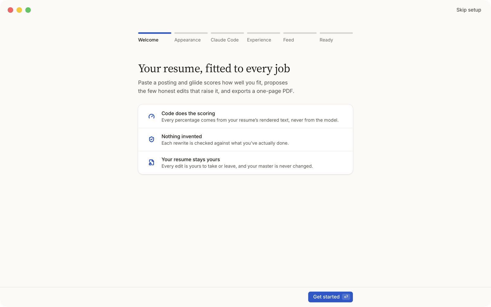

# gliide

From a job posting to a tailored, one-page resume: score the fit against one of your master resumes, review honest
edits (rewrites, skills, entries from your experience bank) with a click each, and export a PDF in your design.
macOS first; Windows and iOS from the same Rust core.



Status: early development; see the roadmap in `ARCHITECTURE.md` §13.

| Document | What it covers |
|---|---|
| [`ARCHITECTURE.md`](ARCHITECTURE.md) | Stack, data model, model access through your own subscription (`claude -p`, `codex exec`, `agy -p`), scoring, change engine, rendering, roadmap |
| [`design/DESIGN.md`](design/DESIGN.md) | The "Paper & Ink" design system: tokens, components, motion, screen recipes |
| [`AGENTS.md`](AGENTS.md) | Rules for coding agents working in this repo |

## Install

Download `gliide_<version>_aarch64.dmg` from the [latest release](https://github.com/bubb4rd/gliide/releases/latest),
open it and drag gliide to Applications. The app is signed with a Developer ID and notarized by Apple, so it opens
without a Gatekeeper warning. It runs on macOS on Apple Silicon and needs one agent CLI installed and signed in with
your own subscription: [Claude Code](https://code.claude.com) (`claude`), [Codex](https://developers.openai.com/codex/cli)
(`codex`, with a ChatGPT plan) or [Antigravity](https://antigravity.google/docs/getting-started) (`agy`, with a Google AI
plan). gliide launches the one you choose for every model call and never asks for or stores an API key. First-run
setup checks for them.

From 0.2.0 on, gliide looks for a newer release at launch and once a day and says so in the sidebar; **Restart to
update** (Settings → About) installs it. Only a release signed with the project's update key installs. Copies older
than 0.2.0 update once by hand, from the latest release.

## Build prerequisites

- macOS on Apple Silicon (the tested platform; no other platform is built yet).
- Rust stable, 1.90 or newer (the workspace uses edition 2024; the updater plugin needs 1.90), via [rustup](https://rustup.rs).
- Node.js 20.19+ or 22.12+ (Vite 8) and pnpm 9 (`corepack enable` picks up `packageManager` in `app/package.json`).
- An agent CLI installed and signed in with your own subscription: [Claude Code](https://code.claude.com) (`claude`),
  [Codex](https://developers.openai.com/codex/cli) (`codex`) or
  [Antigravity](https://antigravity.google/docs/getting-started) (`agy`). gliide launches it; it never asks for or
  stores an API key.

## Build and run

```sh
cd app
pnpm install
pnpm tauri dev
```

`pnpm tauri dev` uses the `tauri` script in `app/package.json` (or install the CLI with
`cargo install tauri-cli --version "^2"`). App data lives in `~/Library/Application Support/dev.bubb4rd.gliide/`;
exports and `applications.csv` go to `~/Documents/Resumes` (Settings → Export folder).

A local release build: `pnpm tauri build` from `app/`. It's unsigned, which is fine on the machine that built it;
macOS warns on other Macs.

### Development

- Tests: `cargo test --workspace`, and `pnpm check` in `app/`.
- Design lint: `node design/lint.mjs`. Specimen: **Specimen** in the sidebar of a dev build (`/specimen`).
- After changing `app/src-tauri/src/dto.rs`, `cargo test -p gliide` regenerates the TypeScript bindings in
  `app/src/lib/api/bindings/`.

### Releasing (maintainers)

Official releases are signed with a Developer ID and notarized, and carry a bundle signed with the update key, which
installed copies take. Contributors never need any of this.

1. Bump the version in `app/package.json`, `app/src-tauri/Cargo.toml` and `app/src-tauri/tauri.conf.json` (the
   script refuses to run while they differ); commit, tag `vX.Y.Z` and push both.
2. `pnpm release:mac` from `app/`, with `RELEASE_NOTES` set to show beside the update in Settings → About. It needs
   a Developer ID Application certificate, an App Store Connect API key and the update key
   (`~/.tauri/gliide-updater.key` and its password); `app/scripts/release-macos.sh` lists what it reads. It writes
   the `.dmg`, `gliide.app.tar.gz` (with its `.sig`) and `latest.json`.
3. Attach all three to the GitHub release `vX.Y.Z`, marked latest (the script prints the `gh release create`
   line). Installed copies read `releases/latest/download/latest.json`, so a release without it updates no one.

The update key (made once with `pnpm tauri signer generate -w ~/.tauri/gliide-updater.key`; its public half is
`plugins.updater.pubkey` in `tauri.conf.json`) must be kept with its password somewhere safe: without it, installed
copies can never take another update; anyone holding both can ship one to them.

App icon: `pnpm tauri icon src-tauri/app-icon.png` (`icon-art.png` is the full-bleed art, kept for iOS).

### Command line

Core and rendering (`cargo run -p ez-cli --bin ez -- …`; outputs belong under the gitignored `local/`):

| Command | Does |
|---|---|
| `ez migrate <master.json> --out <dir>` | A v1 single-resume `master.json` → `bank.json` + `masters/swe.json` |
| `ez import <file> --out <dir> [--bank <f>] [--title "Graphic Design"] [--separate <id,…>] [--contact] [--agent claude\|codex\|antigravity] [--model <name>]` | A resume (`.pdf`, `.docx`, `.md`, `.txt`; or a v1 JSON such as an earlier run's `imported.json`, which skips the model) copied with the agent (`claude -p` unless `--agent` names another; `--model` defaults to the agent's) and merged into the bank; writes `imported.json`, `bank.json`, `masters/<id>.json` and prints where each part went |
| `ez render --bank <f> --master <f> --out <dir> [--highlight] [--system-fonts] [--scale N] [--bench N]` | `resume.pdf`, `page-N.svg`, `page-N.png`, `metrics.json` |
| `ez schema --out schemas/` | Regenerates `schemas/bank.schema.json`, `schemas/master.schema.json` and `schemas/story.schema.json` |
| `ez score <link\|file\|-\|text> --bank <f> --master <f> [--agent claude\|codex\|antigravity] [--model <name>] [--fresh] [--json <f>]` | Reads the posting, extracts its requirements with the agent (cached in `local/cache/`, per model), prints the composite score and every component |
| `ez rank <link\|file\|-\|text> --bank <f> --masters <dir> [--agent claude\|codex\|antigravity] [--model <name>]` | Scores every master in the folder against the posting, best first |
| `ez tailor <link\|file\|-\|text> --bank <f> --master <f> --out <dir> [--mode master-only\|bank-aware] [--draft <f>] [--agent claude\|codex\|antigravity] [--model <name>] [--extract-model <name>] [--fresh]` | Extract and Suggest (both cached in `local/cache/`), the change set, the fit check; writes `tailored.json`, `resume.pdf`, highlighted `page-N.png`, `changes.json` (state, points, flags per change); prints now → projected (ceiling), the page status and every change |

## What leaves your machine

Your bank, masters, drafts and applications stay in the local SQLite store and your export folder. The app's own
network requests are these (links you open, such as a posting or Maps, go to your browser or Maps):

| Request | When | What is sent |
|---|---|---|
| Your agent CLI (`claude -p`, `codex exec` or `agy -p`) | Extract, Suggest, Rewrite, Instruct, import, cover letters | The prompt (posting text, the resume being tailored, your notes) goes to the model through the CLI you installed, under your own account with its maker |
| A posting's page or its board's API (Greenhouse, Lever, Ashby, Workday, SmartRecruiters, Workable, Recruitee…) | You paste a link; a feed job is read | The link |
| [freehire](https://freehire.me) public API and `logo.freehire.me` | Feed pulls and searches (when the feed is on); company logos | Your feed filters and search words; company names |
| Company websites | A feed company's logo freehire doesn't have | A request for the site's icon |
| Watchlist boards | Feed pulls, for the companies you add | The board's public job list request |
| LinkedIn's guest job search | **Only if you turn it on** (Settings → Feed; off by default). LinkedIn's User Agreement doesn't allow automated access; the choice and its consequences are yours | Master titles, countries, seniority, your search words |
| [Fantastic.jobs](https://fantastic.jobs) via [Apify](https://apify.com) | Only with your Apify token in Settings; once a day | Your token, master titles, countries, years and employment filters |
| OpenStreetMap [Nominatim](https://nominatim.org) | The review's map, once per place | The job's place name |
| [OpenFreeMap](https://openfreemap.org) tiles | The review's map | Tile requests for the map area |
| [GitHub](https://github.com/bubb4rd/gliide/releases) releases | At launch and once a day, unless Settings → About → Check for updates is off; Check now; Restart to update | A request for `latest.json` (and, when you update, the release's bundle). Nothing about you or your data |

No telemetry, analytics or crash reporting: the app sends nothing about you or your usage to the project. The webview
runs under a Content Security Policy (`app.security.csp` in `app/src-tauri/tauri.conf.json`): scripts only from the
app itself, and the only remote host it may reach is the map tiles'; everything else goes through the Rust side.

Map data © [OpenStreetMap](https://www.openstreetmap.org/copyright) contributors, available under the Open Database
License (ODbL); tiles by [OpenFreeMap](https://openfreemap.org) in the [OpenMapTiles](https://openmaptiles.org)
schema. The map shows this credit.

## License

gliide is free software under the [GNU Affero General Public License v3.0 only](LICENSE) (`AGPL-3.0-only`).
Bundled fonts, glyphs and other third-party material keep their own licenses: see
[`THIRD_PARTY_NOTICES.md`](THIRD_PARTY_NOTICES.md). Contributing: [`CONTRIBUTING.md`](CONTRIBUTING.md); security
reports: [`SECURITY.md`](SECURITY.md).

**Trademarks.** The logos in `app/static/sources/` and `app/static/agents/` and any company logo the app shows are
trademarks of their owners, used only to identify their services. gliide is not affiliated with, sponsored or
endorsed by any of them.
